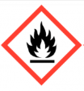

# FDS 9: transcripción documental automática

> Fuente: `FDS EVALUADAS/FDS 2018/FDS 9 - OXIGEL.pdf`
> Páginas PDF: 4
> SHA256 original: a14a593dca5c124aab14e09a475ff89c8cac0a2e24fbe8540f3823dcaa4a3761
> Precaución: transcripción no validada de manera integral; no usar resultados de seguridad sin contrastar la ficha PDF original.

---

## Página PDF 1

HOJA DE SEGURIDAD
1
OXIGEL
138
2
0
Página 1 de
4

### 1. IDENTIFICACION DEL FABRICANTE Y DE LA SUSTANCIA QUIMICA

Empresa:
TECNIDECOR S.A.S
Nit:
900112215-2
Pbx:
444 49 44
Nombre del Producto:
OXIGEL
Código del producto:
138
Sinónimos:
N/A
Fórmula:
C35H49O29
Número UN:
N/A
Clase UN:

### 2-1-0

Fecha de actualización:
Octubre de 2018

### 2. COMPOSICION, INFORMACION SOBRE INGREDIENTES

COMPONENTE
NUMERO CAS
Xanthan gum
11138-66-2

### 3. IDENTIFICACION DE RIESGOS

El producto no está clasificado como peligroso.
En condiciones de uso normal y en su forma original, el producto no tiene ningún otro efecto negativo para la salud y el medio
ambiente
Salud 2 - Riesgo moderado
Inflamabilidad 1 - Riesgo moderado
Reactividad 0 - Riesgo mínimo
SALUD
2
INFLAMABLE
1
PELIGRO FÍSICO
0
PROTECCIOÓN PERSONAL

### 4. PRIMEROS AUXILIOS

Debido a la composición y a la tipología de las sustancias presentes en el preparado, no se necesitan advertencias
particulares.
Inhalación. Situar al accidentado al aire libre, mantenerle caliente y en reposo, si la respiración es irregular o se detiene,
practicar respiración artificial. No administrar nada por la boca. Si está inconsciente, ponerle en una posición adecuada y
buscar ayuda médica. Contacto con los ojos. En caso de llevar lentes de contacto, quitarlas. Lavar abundantemente los ojos
con agua limpia y fresca durante, por lo menos, 10 minutos, tirando hacia arriba de los párpados y buscar asistencia médica.
Contacto con la piel. Quitar la ropa contaminada. Lavar la piel vigorosamente con agua y jabón o un limpiador de piel
adecuado. NUNCA utilizar disolventes o diluyentes.
Ingestión. Si accidentalmente se ha ingerido, buscar inmediatamente atención médica. Mantenerle en reposo. NUNCA
provocar el vómito
No se conocen efectos agudos o retardados derivados de la exposición al producto
Indicación de toda atención médica y de los tratamientos especiales que deban dispensarse inmediatamente. En los casos de
duda, o cuando persistan los síntomas de malestar, solicitar atención médica. No administrar nunca nada por vía oral a
personas que se encuentre inconscientes.

#### Imagen incrustada — PDF página 1, aparición 1

> Sección aproximada: 4; posición: (95.8, 36.0, 192.2, 84.4). Verificar contenido visual con PDF.

#### Imagen incrustada — PDF página 1, aparición 2

> Sección aproximada: 4; posición: (209.0, 424.6, 264.6, 485.0). Verificar contenido visual con PDF.

#### Imagen incrustada — PDF página 1, aparición 3

> Sección aproximada: 4; posición: (282.6, 424.6, 336.4, 480.2). Verificar contenido visual con PDF.

#### Imagen incrustada — PDF página 1, aparición 4

> Sección aproximada: 4; posición: (60.2, 469.8, 81.6, 491.2). Verificar contenido visual con PDF.

#### Imagen incrustada — PDF página 1, aparición 5

> Sección aproximada: 4; posición: (84.2, 470.2, 105.2, 491.2). Verificar contenido visual con PDF.

#### Imagen incrustada — PDF página 1, aparición 6

> Sección aproximada: 4; posición: (105.2, 470.2, 126.2, 491.2). Verificar contenido visual con PDF.

#### Imagen incrustada — PDF página 1, aparición 7

> Sección aproximada: 4; posición: (128.8, 470.0, 150.2, 491.2). Verificar contenido visual con PDF.

#### Imagen incrustada — PDF página 1, aparición 8

> Sección aproximada: 4; posición: (56.6, 98.4, 75.2, 120.4). Verificar contenido visual con PDF.

#### Imagen incrustada — PDF página 1, aparición 9

> Sección aproximada: 4; posición: (56.6, 245.2, 76.6, 264.6). Verificar contenido visual con PDF.

#### Imagen incrustada — PDF página 1, aparición 10

> Sección aproximada: 4; posición: (56.6, 310.8, 80.0, 330.8). Verificar contenido visual con PDF.

#### Imagen incrustada — PDF página 1, aparición 11

> Sección aproximada: 4; posición: (56.6, 513.0, 84.0, 536.6). Verificar contenido visual con PDF.

---

## Página PDF 2

HOJA DE SEGURIDAD
1
OXIGEL
138
2
0
Página 2 de
4

### 5. COMBATE DE INCENDIOS

Medios de extinción recomendados. Polvo extintor o CO2. E
n caso de incendios más graves también espuma resistente al alcohol y agua pulverizada.
No usar para la extinción chorro directo de agua
Peligros específicos derivados de la sustancia. Riesgos especiales. El fuego puede producir un espeso humo negro. Como
consecuencia de la descomposición térmica, pueden formarse productos peligrosos: monóxido de carbono, dióxido de
carbono.
La exposición a los productos de combustión o descomposición puede ser perjudicial para la salud.
Recomendaciones para el personal de lucha contra incendios. Refrigerar con agua los tanques, cisternas o recipientes
próximos a la fuente de calor o fuego. Tener en cuenta la dirección del viento.
Evitar que los productos utilizados en la lucha contra incendio, pasen a desagües, alcantarillas o cursos de agua.
Equipo de protección contra incendios. Según la magnitud del incendio, puede ser necesario el uso de trajes de protección
contra el calor, equipo respiratorio autónomo, guantes, gafas protectoras o máscaras faciales y botas.

### 6. LIBERACIONES ACCIDENTALES

Precauciones relativas al medio ambiente. Producto no clasificado como peligroso para el medio ambiente, evitar en la
medida de lo posible cualquier vertido
Métodos y material de contención y de limpieza. La zona contaminada debe limpiarse inmediatamente con un
descontaminante adecuado. Echar el descontaminante a los restos y dejarlo durante varios días hasta que no se produzca
reacción, en un envase sin cerrar

### 7.MANEJO Y ALMACENAJE

Precauciones para una manipulación segura.
El producto no requiere medidas especiales de manipulación, se recomiendan las siguientes medidas generales: Para la
protección personal, ver epígrafe 8. No emplear nunca presión para vaciar los envases, no son recipientes resistentes a la
presión. En la zona de aplicación debe estar prohibido fumar, comer y beber. Cumplir con la legislación sobre seguridad e
higiene en el trabajo. Conservar el producto en envases de un material idéntico al original
Condiciones de almacenamiento seguro, incluidas posibles incompatibilidades.
El producto no requiere medidas especiales de almacenamiento. Como condiciones generales de almacenamiento se deben
evitar fuentes de calor, radiaciones, electricidad y el contacto con alimentos. Mantener lejos de agentes oxidantes y de
materiales fuertemente ácidos o alcalinos. Almacenar según la legislación local. Observar las indicaciones de la etiqueta

### 8. CONTROLES DE EXPOSICION, PROTECCION PERSONAL

El producto NO contiene sustancias con Valores Límite Ambientales de Exposición Profesional.
El producto NO contiene sustancias con Valores Límite Biológicos.

### 9. PROPIEDADES FISICAS Y QUIMICAS.

Aspecto:
Líquido viscoso
Color:
blanco.
Olor:
N.D./N.A.
Umbral olfativo:
N.D./N.A.
pH:
< 5
Punto de Fusión:
N.D./N.A. P
unto/intervalo de ebullición:
N.D./N.A.
Punto de inflamación:
N.D./N.A.
Tasa de evaporación:
N.D./N.A.
Inflamabilidad (sólido, gas):
N.D./N.A.
Límite inferior de explosión:
N.D./N.A.

#### Imagen incrustada — PDF página 2, aparición 1

> Sección aproximada: 9; posición: (95.8, 36.0, 192.2, 84.4). Verificar contenido visual con PDF.

#### Imagen incrustada — PDF página 2, aparición 2

> Sección aproximada: 9; posición: (64.0, 103.4, 84.4, 120.8). Verificar contenido visual con PDF.

#### Imagen incrustada — PDF página 2, aparición 3

> Sección aproximada: 9; posición: (56.6, 266.2, 82.4, 288.2). Verificar contenido visual con PDF.

#### Imagen incrustada — PDF página 2, aparición 4

> Sección aproximada: 9; posición: (61.8, 374.8, 87.4, 394.4). Verificar contenido visual con PDF.

#### Imagen incrustada — PDF página 2, aparición 5

> Sección aproximada: 9; posición: (60.4, 521.6, 83.2, 545.0). Verificar contenido visual con PDF.

#### Imagen incrustada — PDF página 2, aparición 6

> Sección aproximada: 9; posición: (61.8, 587.0, 87.8, 603.6). Verificar contenido visual con PDF.

---

## Página PDF 3

HOJA DE SEGURIDAD
1
OXIGEL
138
2
0
Página 3 de
4
Límite superior de explosión:
N.D./N.A.
Presión de vapor:
N.D./N.A.
Densidad de vapor:
N.D./N.A.
Densidad relativa:
N.D./N.A.
Solubilidad:
Polar.
Liposolubilidad:
N.D./N.A.
idrosolubilidad:
Si.
Coeficiente de reparto (n-octanol/agua): N.D./N.A.
Temperatura de autoinflamación:  N.D./N.A.
Temperatura de descomposición:  N.D./N.A.
Viscosidad:
50 - 70 ku.
Propiedades explosivas:
N.D./N.A.
Propiedades comburentes:
N.D./N.A.
N.D./N.A.= No Disponible/No Aplicable debido a la naturaleza del producto

### 10. ESTABILIDAD Y REACTIVIDAD

El producto no presenta peligros debido a su reactividad
Estable bajo las condiciones de manipulación y almacenamiento recomendadas
El producto no presenta posibilidad de reacciones peligrosas

### 11. INFORMACION TOXICOLOGICA.

El contacto repetido o prolongado con el producto, puede causar la eliminación de la grasa de la piel, dando lugar a una
dermatitis de contacto no alérgica y a que se absorba el producto a través de la piel. Las salpicaduras en los ojos pueden
causar irritación y daños reversibles.
a) toxicidad aguda; Datos no concluyentes para la clasificación.
b) corrosión o irritación cutáneas; Datos no concluyentes para la clasificación.
c) lesiones o irritación ocular graves; Datos no concluyentes para la clasificación.
d) sensibilización respiratoria o cutánea; Datos no concluyentes para la clasificación.
e) mutagenicidad en células germinales; Datos no concluyentes para la clasificación.
f) carcinogenicidad; Datos no concluyentes para la clasificación.
g) toxicidad para la reproducción; Datos no concluyentes para la clasificación.
h) toxicidad específica en determinados órganos (STOT) - exposición única; Datos no concluyentes para la clasificación.
i) toxicidad específica en determinados órganos (STOT) - exposición repetida; Datos no concluyentes para la clasificación.
j) peligro de aspiración; Datos no concluyentes para la clasificación

### 12. INFORMACION ECOLOGICA.

Tipo
Ensayo
Especie
Valor
Peces
LC50
Oncorhynchus mykiss
320-560 mg/l (96 h)

### 13. CONSIDERACIONES SOBRE LA DISPOSICION.

No se permite su vertido en alcantarillas o cursos de agua. Los residuos y envases vacíos deben manipularse y eliminarse de
acuerdo con las legislaciones local/nacional vigentes. Seguir las disposiciones de la Directiva 2008/98/CE respecto a la gestión
de residuos

### 14. INFORMACION SOBRE EL TRANSPORTE.

No es peligroso en el transporte
Número UN: N/A
Grupo de embalaje: N/A

#### Imagen incrustada — PDF página 3, aparición 1

> Sección aproximada: 14; posición: (95.8, 36.0, 192.2, 84.4). Verificar contenido visual con PDF.

#### Imagen incrustada — PDF página 3, aparición 2

> Sección aproximada: 14; posición: (61.8, 253.8, 81.4, 275.0). Verificar contenido visual con PDF.

#### Imagen incrustada — PDF página 3, aparición 3

> Sección aproximada: 14; posición: (56.6, 326.8, 81.0, 350.0). Verificar contenido visual con PDF.

#### Imagen incrustada — PDF página 3, aparición 4

> Sección aproximada: 14; posición: (56.6, 505.2, 81.0, 527.8). Verificar contenido visual con PDF.

#### Imagen incrustada — PDF página 3, aparición 5

> Sección aproximada: 14; posición: (61.8, 569.2, 85.0, 591.6). Verificar contenido visual con PDF.

#### Imagen incrustada — PDF página 3, aparición 6

> Sección aproximada: 14; posición: (56.6, 643.4, 78.8, 666.0). Verificar contenido visual con PDF.

---

## Página PDF 4

HOJA DE SEGURIDAD
1
OXIGEL
138
2
0
Página 4 de
4

### 15. INFORMACION SOBRE REGLAMENTACION.

Algunos de sus componentes estan regulados para el transporte, se debe dar cumplimiento al Decreto 1609 de 2002.
Ministerio de Transporte.

### 16. OTRA INFORMACION.

Esta hoja de seguridad tiene como fin sólo a brindar una guía basada en la Norma NTC 4435. Para el manejo del material con
la precaución apropiada Las personas que reciban la información deben ejercer su propio criterio para determinar la
conveniencia del uso de este producto para un fin específico. TECNIDECOR S.A.S no se hace responsable de ningún daño
causado a propiedades o a personas por el uso inadecuado de nuestros productos, ya que no conocemos la manipulación ni
las precauciones que cada cliente tiene en el almacenamiento.

#### Imagen incrustada — PDF página 4, aparición 1

> Sección aproximada: 16; posición: (95.8, 36.0, 192.2, 84.4). Verificar contenido visual con PDF.

#### Imagen incrustada — PDF página 4, aparición 2

> Sección aproximada: 16; posición: (61.8, 99.2, 87.0, 120.4). Verificar contenido visual con PDF.

#### Imagen incrustada — PDF página 4, aparición 3

> Sección aproximada: 16; posición: (61.8, 161.8, 84.2, 180.8). Verificar contenido visual con PDF.

