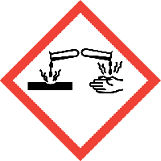
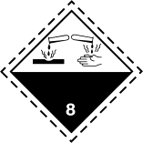

# FDS 11: transcripción documental automática

> Fuente: `FDS EVALUADAS/FDS 2018/FDS 11  - Ecosphere Premium.pdf`
> Páginas PDF: 9
> SHA256 original: b3101d2b023abb5fb7b8fe13928b980e20ffc190ef58cdc0a5042d53889e16ed
> Precaución: transcripción no validada de manera integral; no usar resultados de seguridad sin contrastar la ficha PDF original.

---

## Página PDF 1

> Nota de proceso: reextracción automática de líneas según su posición en el PDF. La asociación de filas/columnas debe verificarse visualmente.

                                   Fichas de datos de seguridad
                                      Según 1907/2006/CE (REACH), 2015/830/EU
                             ECOSPHERE PREMIUM
                                        G012P20I000

### SECCIÓN 1: IDENTIFICACIÓN DE LA SUSTANCIA O LA MEZCLA Y DE LA SOCIEDAD DE LA EMPRESA

 1.1    Identificador del producto: Ecosphere Premium (G012P20I000)
 1.2   Usos pertinentes identificados de la sustancia o de la mezcla y usos desaconsejados:
       Usos pertinentes: Pintura de uso arquitectónico
       Usos desaconsejados: Todo aquel uso no especificado en este epígrafe ni en el epígrafe 7.3
 1.3   Datos del proveedor de la ficha de datos de seguridad:
         Industria Española para el Desarrollo e Investigación 2100, S.A. (IEDISA)
          c/ Carpintero, 25 41520 El Viso del Alcor - Sevilla - España
         Tfno.: +34 955 292 068 / +34 693 026 242
        Email: info@graphstone.com
       Web: http://www.graphenstone.com
 1.4   Teléfono de emergencia: +34 693 026 242

### SECCIÓN 2: IDENTIFICACIÓN DE LOS PELIGROS

 2.1    Clasificación de la sustancia o de la mezcla: Reglamento nº 1272/ 2008 (CLP):
       La clasificación de este producto se ha realizado conforme el Reglamento nº 1272/ 2008 (CLP).
       Eye Dam. 1: Lesiones oculares graves, Categoría 1, H318
        Skin Sens. 1: Sensibilización cutánea, Categoría 1, H317
 2.2   Elementos de la etiqueta:
       Reglamento nº 1272/ 2008 (CLP):
      PELIGRO
        Indicaciones de peligro:
       Eye Dam. 1: H318 Lesiones oculares graves, Categoría 1
        Skin Sens. 1: H317 Puede provocar una reacción alérgica en la piel.
       Consejos de prudencia:
        P101: Si se necesita consejo médico, tener a mano el envase o la etiqueta.
        P102: Mantener fuera del alcance de los niños.
        P264: Lavarse concienzudamente tras la manipulación P280: Llevar guantes/ prendas/ gafas/ máscara de protección.
       P301+ P330+ P331: EN CASO DE INGESTIÓN: Enjuagar la boca. NO provocar el vómito.
       P304+ P340: EN CASO DE INHALACIÓN: Transportar a la persona al aire libre y mantenerla en una posición que le facilite la
         respiración.
       P305+ P351+ P338: EN CASO DE CONTACTO CON LOS OJOS: Enjuagar con agua cuidadosamente durante varios minutos.
        Quitar las lentes de contacto cuando estén presentes y pueda hacerse con facilidad. Proseguir con el lavado.
       P501: Eliminar el contenido/ el recipiente mediante el sistema de recogida selectiva habilitado en su municipio.
       Sustancias que contribuyen a la clasificación:
        Dihidroxido de calcio
 2.3   Otros peligros:
      No relevante

### SECCIÓN 3: COMPOSICIÓN/INFORMACIÓN SOBRE LOS COMPONENTES

 3.1    Sustancia:
      No aplicable.
  3.2   Mezclas:
        Descripción química: Mezcla a base de sustancias minerales.
       Componentes: De acuerdo al Anexo II del Reglamento (CE) nº 1907/2006 (punto 3), el producto presenta:
                  Identificación                                      Nombre químico/clasificación                                    Concentración
    CAS: 1305-62-0                  Dihidróxido de calcio                                                                   Autoclasificada
    CE: 215-137-3
     Index: No aplicable               Reglamento 1272/2008   Eye Dam. 1: H318; Skin Irrit. 2: H315; STOT SE 3: H335 – Peligro                 10 - < 25 %
    REACH: 01-2119475151-45-XXXX
Versión: 3
Fecha de emisión: ene-18
                                                                                                         Página 1 de 9

#### Imagen incrustada — PDF página 1, aparición 1

> Sección aproximada: 10; posición: (54.0, 35.2, 166.4, 91.9). Verificar contenido visual con PDF.

#### Imagen incrustada — PDF página 1, aparición 2

> Sección aproximada: 10; posición: (453.8, 36.3, 496.3, 78.8). Verificar contenido visual con PDF.

#### Imagen incrustada — PDF página 1, aparición 3

> Sección aproximada: 10; posición: (498.8, 36.4, 541.3, 78.9). Verificar contenido visual con PDF.

#### Imagen incrustada — PDF página 1, aparición 4

> Sección aproximada: 10; posición: (86.3, 377.8, 114.6, 406.0). Verificar contenido visual con PDF.

#### Imagen incrustada — PDF página 1, aparición 5

> Sección aproximada: 10; posición: (117.5, 377.8, 145.8, 406.0). Verificar contenido visual con PDF.

#### Imagen incrustada — PDF página 1, aparición 6

> Sección aproximada: 10; posición: (449.5, 745.0, 463.7, 759.1). Verificar contenido visual con PDF.

#### Imagen incrustada — PDF página 1, aparición 7

> Sección aproximada: 10; posición: (463.7, 745.0, 477.9, 759.1). Verificar contenido visual con PDF.

---

## Página PDF 2

Fichas de datos de seguridad
Según 1907/2006/CE (REACH), 2015/830/EU
ECOSPHERE PREMIUM
G012P20I000

### SECCIÓN 4: PRIMEROS AUXILIOS

4.1
Descripción de los primeros auxilios:
Los síntomas como consecuencia de una intoxicación pueden presentarse con posterioridad a la exposición, por lo que, en caso
de duda, exposición directa al producto químico o persistencia del malestar solicitar atención médica, mostrándole la FDS de este
producto.
Por inhalación:
Se trata de un producto no clasificado como peligroso por inhalación, sin embargo, se recomienda en caso de síntomas de intoxica-
ción sacar al afectado del lugar de exposición, suministrarle aire limpio y mantenerlo en reposo. Solicitar atención médica en el caso
de que los síntomas persistan.
Por contacto con la piel:
Quitar la ropa y los zapatos contaminados, aclarar la piel o duchar al afectado si procede con abundante agua fría y jabón neutro.
En caso de afección importante acudir al médico. Si el producto produce quemaduras o congelación, no se debe quitar la ropa
debido a que podría empeorar la lesión producida si esta se encuentra pegada a la piel. En el caso de formarse ampollas en la piel,
éstas nunca deben reventarse ya que aumentaría el riesgo de infección.
Por contacto con los ojos:
Enjuagar los ojos con abundante agua a temperatura ambiente al menos durante 15 minutos. Evitar que el afectado se frote o cierre
los ojos. En el caso de que el accidentado use lentes de contacto, éstas deben retirarse siempre que no estén pegadas a los ojos,
de otro modo podría producirse un daño adicional. En todos los casos, después del lavado, se debe acudir al médico lo más rápida-
mente posible con la FDS del producto.
Por ingestión/ aspiración:
No inducir al vómito, porque su expulsión del estómago puede provocar daños en la mucosa del tracto digestivo superior, y su
aspiración, al respiratorio. En el caso de que se produzca el vómito, mantener inclinada la cabeza hacia delante para evitar la aspi-
ración. Enjuagar la boca y la garganta, ya que existe la posibilidad de que hayan sido afectadas en la ingestión. En el caso de pérdida
de consciencia no administrar nada por vía oral hasta la supervisión del médico. Mantener al afectado en reposo.
4.2
Principales síntomas y efectos, agudos y retardados:
Los efectos agudos y retardados son los indicados en las secciones 2 y 11.
4.3
Indicación de toda atención médica y de los tratamientos especiales que deban dispensarse inmediatamente:
No relevante

### SECCIÓN 5: MEDIDAS DE LUCHA CONTRA INCENDIOS

5.1
Medios de extinción:
Producto no inflamable bajo condiciones normales de almacenamiento, manipulación y uso. En caso de inflamación como
consecuencia de manipulación, almacenamiento o uso indebido emplear preferentemente extintores de polvo polivalente
(polvo ABC), de acuerdo al Reglamento de instalaciones de protección contra incendios (R.D. 1942/ 1993 y posteriores mo-
dificaciones). NO SE RECOMIENDA emplear agua a chorro como agente de extinción.
5.2
Peligros específicos derivados de la sustancia o la mezcla:
Debido a sus características de inflamabilidad, el producto no presenta riesgo de incendio bajo condiciones normales de almacena-
miento, manipulación y uso.
5.3
Recomendaciones para el personal de lucha contra incendios:
En función de la magnitud del incendio puede hacerse necesario el uso de ropa protectora completa y equipo de respiración
autónomo. Disponer de un mínimo de instalaciones de emergencia o elementos de actuación (mantas ignífugas, botiquín
portátil...) conforme al R.D.486/ 1997 y posteriores modificaciones
Disposiciones adicionales:
Actuar conforme el Plan de Emergencia Interior y las Fichas Informativas sobre actuación ante accidentes y otras emergen-
cias. Suprimir cualquier fuente de ignición. En caso de incendio, refrigerar los recipientes y tanques de almacenamiento de
productos susceptibles a inflamación, explosión o BLEVE como consecuencia de elevadas temperaturas. Evitar el vertido de
los productos empleados en la extinción del incendio al medio acuático.

### SECCIÓN 6: MEDIDAS EN CASO DE VERTIDO ACCIDENTAL

6.1
Precauciones personales, equipo de protección y procedimientos de emergencia:
Aislar las fugas siempre y cuando no suponga un riesgo adicional para las personas que desempeñen esta función. Ante la exposición
potencial con el producto derramado se hace obligatorio el uso de elementos de protección personal (ver sección 8). Evacuar la
zona y mantener a las personas sin protección alejadas.
Versión: 3
Fecha de emisión: ene-18
Página 2 de 9

#### Imagen incrustada — PDF página 2, aparición 1

> Sección aproximada: 6; posición: (54.0, 35.2, 166.4, 91.9). Verificar contenido visual con PDF.

#### Imagen incrustada — PDF página 2, aparición 2

> Sección aproximada: 6; posición: (453.8, 36.3, 496.3, 78.8). Verificar contenido visual con PDF.

#### Imagen incrustada — PDF página 2, aparición 3

> Sección aproximada: 6; posición: (498.8, 36.4, 541.3, 78.9). Verificar contenido visual con PDF.

---

## Página PDF 3

Fichas de datos de seguridad
Según 1907/2006/CE (REACH), 2015/830/EU
ECOSPHERE PREMIUM
G012P20I000
6.2
Precauciones relativas al medio ambiente:
Producto no clasificado como peligroso para el medioambiente. Mantener el producto alejado de los desagües y de las aguas
superficiales y subterráneas.
6.3
Métodos y material de contención y de limpieza:
Se recomienda:
Absorber el vertido mediante arena o absorbente inerte y trasladarlo a un lugar seguro. No absorber en serrín u otros absorbentes
combustibles. Para cualquier consideración relativa a la eliminación consultar la sección 13.
6.4
Referencias a otras secciones:
Ver secciones 8 y 13.

### SECCIÓN 7: MANIPULACIÓN Y ALMACENAMIENTO

7.1
Precauciones para una manipulación segura:
A.- Precauciones generales
Cumplir con la legislación vigente en materia de prevención de riesgos laborales. Mantener los recipientes herméticamente
cerrados. Controlar los derrames y residuos, eliminándolos con métodos seguros (sección 6). Evitar el vertido libre desde el
recipiente. Mantener orden y limpieza donde se manipulen productos peligrosos.
B.- Recomendaciones técnicas para la prevención de incendios y explosiones.
Producto no inflamable bajo condiciones normales de almacenamiento, manipulación y uso. Se recomienda trasvasar a ve-
locidades lentas para evitar la generación de cargas electroestáticas que pudieran afectar a productos inflamables. Consultar
la sección 10 sobre condiciones y materias que deben evitarse.
C.- Recomendaciones técnicas para prevenir riesgos ergonómicos y toxicológicos.
Para control de exposición consultar la sección 8. No comer, beber ni fumar en las zonas de trabajo; lavarse las manos
después de cada utilización, y despojarse de prendas de vestir y equipos de protección contaminados antes de entrar en las
zonas para comer.
D.- Recomendaciones técnicas para prevenir riesgos medioambientales
Se recomienda disponer de material absorbente en las proximidades del producto (ver epígrafe 6.3)
7.2
Condiciones de almacenamiento seguro, incluidas posibles incompatibilidades:
A.- Medidas técnicas de almacenamiento
ITC (R.D.379/2001):
MI E-APQ-6
Clasificación:
b)
Tª mínima:
5 ºC
Tª máxima:
30 ºC
Tiempo máximo
6 meses
B.- Condiciones generales de almacenamiento.
Evitar fuentes de calor, radiación, electricidad estática y el contacto con alimentos. Para información adicional ver epígrafe
10.5
7.3
Usos específicos finales:
Salvo las indicaciones ya especificadas no es preciso realizar ninguna recomendación especial en cuanto a los usos de este
producto.

### SECCIÓN 8: CONTROLES DE EXPOSICIÓN/PROTECCIÓN INDIVIDUAL

8.1
Parámetros de control:
Sustancias cuyos valores límite de exposición profesional han de controlarse en el ambiente de trabajo (I NSHT 2017):
Identificación
Valores límites ambientales
Dihidróxido de calcio
VLA-ED
5 mg/m3
CAS: 1305-62-0
VLA-EC
CE: 215-137-3
Año
2016
DNEL (Trabajadores):
Corta exposición
Larga exposición
Identificación
Sistemática
Local
Sistemática
Local
No relevante
No relevante
No relevante
No relevante
Dihidróxido de calcio
Oral
No relevante
No relevante
No relevante
No relevante
CAS: 1305-62-0
Cutánea
CE: 215-137-3
Inhalación
No relevante
4 mg/m3
No relevante
1 mg/m3
DNEL (Población):
Versión: 3
Fecha de emisión: ene-18
Página 3 de 9

#### Imagen incrustada — PDF página 3, aparición 1

> Sección aproximada: 8; posición: (54.0, 35.2, 166.4, 91.9). Verificar contenido visual con PDF.

#### Imagen incrustada — PDF página 3, aparición 2

> Sección aproximada: 8; posición: (453.8, 36.3, 496.3, 78.8). Verificar contenido visual con PDF.

#### Imagen incrustada — PDF página 3, aparición 3

> Sección aproximada: 8; posición: (498.8, 36.4, 541.3, 78.9). Verificar contenido visual con PDF.

---

## Página PDF 4

Fichas de datos de seguridad
Según 1907/2006/CE (REACH), 2015/830/EU
ECOSPHERE PREMIUM
G012P20I000
Corta exposición
Larga exposición
Identificación
Sistemática
Local
Sistemática
Local
Dihidróxido de calcio
Oral
No relevante
No relevante
No relevante
No relevante
CAS: 1305-62-0
No relevante
No relevante
No relevante
No relevante
Cutánea
CE: 215-137-3
Inhalación
No relevante
4 mg/m3
No relevante
1 mg/m3
PNEC:
Identificación
Dihidróxido de calcio
STO
3 mg/l
Agua dulce
0.49 mg/l
CAS: 1305-62-0
Suelo
1080 mg/kg
Agua salada
0.32 mg/l
CE: 215-137-3
Intermitente
0.49 mg/l
Sedimento (agua dulce)
No relevante
Oral
No relevante
Sedimento (agua salada)
No relevante
8.2
Controles de la exposición:
A.- Medidas generales de seguridad e higiene en el ambiente de trabajo:
Como medida de prevención se recomienda la utilización de equipos de protección individual básicos, con el correspondiente
""marcado CE"" de acuerdo al R.D.1407/ 1992 y posteriores modificaciones. Para más información sobre los equipos de
protección individual (almacenamiento, uso, limpieza, mantenimiento, clase de protección…) consultar el folleto informativo
facilitado por el fabricante del EPI. Las indicaciones contenidas en este punto se refieren al producto puro. Las medidas de
protección para el producto diluido podrán variar en función de su grado de dilución, uso, método de aplicación, etc. Para
determinar la obligación de instalación de duchas de emergencia y/ o lavaojos en los almacenes se tendrá en cuenta la
normativa referente al almacenamiento de productos químicos aplicable en cada caso. Para más información ver epígrafes
7.1 y 7.2.
Toda la información aquí incluida es una recomendación siendo necesario su concreción por parte de los servicios de pre-
vención de riesgos laborales al desconocer las medidas de prevención adicionales que la empresa pudiese disponer.
B.- Protección respiratoria.
Pictograma
EPI
Marcado
Normas CEN
Observaciones
Reemplazar cuando se detecte olor o sabor
del contaminante en el interior de la máscara
Máscara autofiltrante para ga-
EN 405:2001+A1:2009
o adaptador facial. Cuando el contaminante
ses y vapores
no tiene buenas propiedades de aviso se re-
Protección obligatoria
comienda el uso de equipos aislantes.
de las vías respirato-
rias
C.- Protección específica de las manos.
Pictograma
EPI
Marcado
Normas CEN
Observaciones
El tiempo de paso (Breakthrough Time)
EN 374-1:2003
indicado por el fabricante ha de ser supe-
Guantes NO desechables
EN 374-3:2003/AC:2006
rior al del tiempo de uso del producto. No
de protección química
EN 420: 2003+A1:2009
emplear cremas protectoras después del
Protección obligatoria
contacto del producto con la piel.
de las manos
Dado que el producto es una mezcla de diferentes materiales, la resistencia del material de los guantes no se puede calcular
de antemano con total fiabilidad y por lo tanto tiene que ser controlados antes de su aplicación.
D.- Protección ocular y facial
Pictograma
EPI
Marcado
Normas CEN
Observaciones
EN 166:2001
Limpiar a diario y desinfectar periodicamente
EN 167:2001
de acuerdo a las instrucciones del fabricante.
Pantalla facial
EN 168:2001 EN I SO
Se recomienda su uso en caso de riesgo de
4007:2012
salpicaduras.
Protección obligatoria
de la cara
E.- Protección corporal
Pictograma
EPI
Marcado
Normas CEN
Observaciones
EN 13034:2005+ A1:2009
EN 168:2001 EN I SO
Uso exclusivo en el trabajo. Limpiar pe-
Prenda de protección frente
13982-1:2004/ A1:2010
riódicamente de acuerdo a las instruc-
a riesgos químicos
EN I SO 6529:2001
ciones del fabricante.
Protección obligatoria
EN I SO 6530:2005 EN
del cuerpo
464:1994
Calzado de seguridad con-
EN ISO 20345:2011
Reemplazar las botas ante cualquier indicio
tra riesgo químico
EN 13832-1:2006
de deterioro.
Protección obligatoria
de los pies
F.- Medidas complementarias de emergencia
Versión: 3
Fecha de emisión: ene-18
Página 4 de 9

#### Imagen incrustada — PDF página 4, aparición 1

> Sección aproximada: 8; posición: (54.0, 35.2, 166.4, 91.9). Verificar contenido visual con PDF.

#### Imagen incrustada — PDF página 4, aparición 2

> Sección aproximada: 8; posición: (453.8, 36.3, 496.3, 78.8). Verificar contenido visual con PDF.

#### Imagen incrustada — PDF página 4, aparición 3

> Sección aproximada: 8; posición: (498.8, 36.4, 541.3, 78.9). Verificar contenido visual con PDF.

#### Imagen incrustada — PDF página 4, aparición 4

> Sección aproximada: 8; posición: (109.7, 374.5, 143.7, 408.5). Verificar contenido visual con PDF.

#### Imagen incrustada — PDF página 4, aparición 5

> Sección aproximada: 8; posición: (261.0, 382.1, 303.5, 426.2). Verificar contenido visual con PDF.

#### Imagen incrustada — PDF página 4, aparición 6

> Sección aproximada: 8; posición: (111.9, 460.5, 145.9, 494.5). Verificar contenido visual con PDF.

#### Imagen incrustada — PDF página 4, aparición 7

> Sección aproximada: 8; posición: (261.0, 463.9, 303.5, 508.0). Verificar contenido visual con PDF.

#### Imagen incrustada — PDF página 4, aparición 8

> Sección aproximada: 8; posición: (111.9, 558.4, 145.9, 592.4). Verificar contenido visual con PDF.

#### Imagen incrustada — PDF página 4, aparición 9

> Sección aproximada: 8; posición: (261.2, 562.0, 303.1, 605.8). Verificar contenido visual con PDF.

#### Imagen incrustada — PDF página 4, aparición 10

> Sección aproximada: 8; posición: (111.9, 636.1, 145.9, 670.1). Verificar contenido visual con PDF.

#### Imagen incrustada — PDF página 4, aparición 11

> Sección aproximada: 8; posición: (261.0, 639.7, 303.5, 683.5). Verificar contenido visual con PDF.

#### Imagen incrustada — PDF página 4, aparición 12

> Sección aproximada: 8; posición: (111.9, 688.5, 145.9, 722.5). Verificar contenido visual con PDF.

#### Imagen incrustada — PDF página 4, aparición 13

> Sección aproximada: 8; posición: (261.0, 692.1, 303.5, 735.8). Verificar contenido visual con PDF.

---

## Página PDF 5

Fichas de datos de seguridad
Según 1907/2006/CE (REACH), 2015/830/EU
ECOSPHERE PREMIUM
G012P20I000
Medidas de emergencias
Normas
Marcado
Normas
ANSI Z358-1
DIN 12 899
ISO 3864-1: 2002
ISO 3864-1:2002
Ducha de emergencia
Lavar ojor
Controles de la exposición del medio ambiente:
En virtud de la legislación comunitaria de protección del medio ambiente se recomienda evitar el vertido tanto del producto como
de su envase al medio ambiente. Para información adicional ver epígrafe 7.1.D
Compuestos orgánicos volátiles:
En aplicación al R.D.117/ 2003 y posteriores modificaciones (Directiva 2010/75/EU), este producto presenta las siguientes ca-
racterísticas:
C.O.V. (suministro):
0% peso
Concentración C.O.V. a 20ºC:
0.01 g/l
Número de carbonos medio:
3.92
Peso molecular:
113 g/mol

### SECCIÓN 9: PROPIEDADES FÍSICAS Y QUÍMICAS

9.1
Información de propiedades físicas y químicas básicas:
Para completar la información ver la ficha técnica/ hoja de especificaciones del producto.
Aspecto físico:
Aspecto
Líquido denso
Olor:
No determinado
Volatilidad:
Temperatura de ebullición a presión atmosférica:
100 ºC
Presión de vapor a 20 ºC:
2350 Pa
Presión de vapor a 50 ºC:
12381 Pa (12 kPa)
Tasa de evaporación a 20 ºC:
No relevante*
Caracterización del producto:
Densidad a 20 ºC:
1370 kg/m3
Densidad relativa a 20 ºC:
1.37
Viscosidad dinámica a 20 ºC:
800 cP
pH:
12.5
Densidad de vapor a 20 ºC:
No relevante*
Coeficiente de reparto n-octanol/agua a 20 ºC:
No relevante*
Solubilidad en agua a 20 ºC:
No relevante*
Propiedad de solubilidad:
No relevante*
Propiedades explosivas:
No relevante*
Propiedades comburentes:
No relevante*
Inflamibilidad:
Punto de inflamación:
No infamable (>60 ºC)
Inflamabilidad (sólido, gas):
No relevante*
*No relevante debido a la naturaleza del producto, no aportando información característica de su peligrosidad.

### SECCIÓN 10: ESTABILIDAD Y REACTIVIDAD

10.1
Reactividad:
No se esperan reacciones peligrosas si se cumplen las instrucciones técnicas de almacenamiento de productos químicos. Ver
epígrafe 7.
10.2
Estabilidad química:
Estable químicamente bajo las condiciones indicadas de almacenamiento, manipulación y uso.
10.3
Posibilidad de reacciones peligrosas:
Bajo las condiciones indicadas no se esperan reacciones peligrosas que puedan producir una presión o temperaturas excesi-
vas.
10.4
Condiciones que deben evitarse:
Aplicables para manipulación y almacenamiento a temperatura ambiente:
Choque y fricción
Contacto con el aire
Calentamiento
Luz Solar
Humedad
Evitar incidencia directa
Evitar incidencia directa
Evitar incidencia directa
Evitar incidencia directa
No aplicable
Versión: 3
Fecha de emisión: ene-18
Página 5 de 9

#### Imagen incrustada — PDF página 5, aparición 1

> Sección aproximada: 10; posición: (54.0, 35.2, 166.4, 91.9). Verificar contenido visual con PDF.

#### Imagen incrustada — PDF página 5, aparición 2

> Sección aproximada: 10; posición: (453.8, 36.3, 496.3, 78.8). Verificar contenido visual con PDF.

#### Imagen incrustada — PDF página 5, aparición 3

> Sección aproximada: 10; posición: (498.8, 36.4, 541.3, 78.9). Verificar contenido visual con PDF.

#### Imagen incrustada — PDF página 5, aparición 4

> Sección aproximada: 10; posición: (131.9, 122.5, 165.3, 156.5). Verificar contenido visual con PDF.

#### Imagen incrustada — PDF página 5, aparición 5

> Sección aproximada: 10; posición: (351.8, 122.5, 385.8, 156.5). Verificar contenido visual con PDF.

---

## Página PDF 6

Fichas de datos de seguridad
Según 1907/2006/CE (REACH), 2015/830/EU
ECOSPHERE PREMIUM
G012P20I000
10.5
Materiales incompatibles:
Ácidos
Agua
Materias comburentes
Materias combustibles
Otros
Puede reaccionar violentamente
No aplicable
Precaución
No aplicable
Evitar álcalis o bases fuertes
10.6
Productos de descomposición peligrosos:
Ver epígrafe 10.3, 10.4 y 10.5 para conocer los productos de descomposición específicamente. En dependencia de las
condiciones de descomposición, como consecuencia de la misma pueden liberarse mezclas complejas de sustancias
químicas: dióxido de carbono (CO2), monóxido de carbono y otros compuestos orgánicos.

### SECCIÓN 11: INFORMACIÓN TOXICOLÓGICA

11.1
Información sobre los efectos toxicológicos:
No se dispone de datos experimentales del producto en sí mismos relativos a las propiedades toxicológicas.
Efectos peligrosos para la salud:
En caso de exposición repetitiva, prolongada o a concentraciones superiores a las establecidas por los límites de exposición pro-
fesionales, pueden producirse efectos adversos para la salud en función de la vía de exposición:
A.- Ingestión (efecto agudo):
- Toxicidad aguda: A la vista de los datos disponibles, no se cumplen los criterios de clasificación, sin embargo, presenta
sustancias clasificadas como peligrosas por ingestión. Para más información ver sección 3.
- Corrosividad/ Irritabilidad: Producto corrosivo, su ingesta provoca quemaduras destruyendo los tejidos en todo su espesor.
Para más información sobre efectos secundarios por contacto con la piel ver sección 2.
B- Inhalación (efecto agudo):
- Toxicidad aguda: A la vista de los datos disponibles, no se cumplen los criterios de clasificación, sin embargo, presenta
sustancias clasificadas como peligrosas por inhalación. Para más información ver sección 3.
- Corrosividad/ Irritabilidad: En caso de inhalación prolongada el producto es destructivo para los tejidos de las membranas
mucosas y las vías respiratorias superiores
C- Contacto con la piel y los ojos (efecto agudo):
- Contacto con la piel: Principalmente el contacto con la piel destruye los tejidos en todo su espesor, provocando quemadu-
ras. Para más información sobre efectos secundarios por contacto con la piel ver sección 2.
- Contacto con los ojos: Produce lesiones oculares importantes tras contacto.
D- Efectos CMR (carcinogenicidad, mutagenicidad y toxicidad para la reproducción):
- Carcinogenicidad: A la vista de los datos disponibles, no se cumplen los criterios de clasificación, no presentando sustan-
cias clasificadas como peligrosas por los efectos descritos. Para más información ver sección 3.
- Mutagenicidad: A la vista de los datos disponibles, no se cumplen los criterios de clasificación, no presentando sustancias
clasificadas como peligrosas por este efecto. Para más información ver sección 3.
- Toxicidad para la reproducción: A la vista de los datos disponibles, no se cumplen los criterios de clasificación, no presen-
tando sustancias clasificadas como peligrosas por este efecto. Para más información ver sección 3.
E- Efectos de sensibilización:
- Respiratoria: A la vista de los datos disponibles, no se cumplen los criterios de clasificación, no presentando sustancias
clasificadas como peligrosas con efectos sensibilizantes por encima de los límites recogidos en el punto 3.2 del Reglamento
(CE) 2015/ 830. Para más información ver secciones 2, 3 y 15.
- Cutánea: El contacto prolongado con la piel puede derivar en episodios de dermatitis alérgicas de contacto.
F- Toxicidad específica en determinados órganos (STOT)-exposición única:
- A la vista de los datos disponibles, no se cumplen los criterios de clasificación, sin embargo, presenta sustancias clasifica-
das como peligrosas por inhalación. Para más información ver sección 3.
G- Toxicidad específica en determinados órganos (STOT)-exposición repetida:
- Toxicidad específica en determinados órganos (STOT)-exposición repetida: A la vista de los datos disponibles, no se cum-
plen los criterios de clasificación, no presentando sustancias clasificadas como peligrosas por este efecto. Para más infor-
mación ver sección 3.
- Piel: A la vista de los datos disponibles, no se cumplen los criterios de clasificación, no presentando sustancias clasificadas
como peligrosas por este efecto. Para más información ver sección 3.
H- Peligro por aspiración:
- A la vista de los datos disponibles, no se cumplen los criterios de clasificación, no presentando sustancias clasificadas
como peligrosas por este efecto. Para más información ver sección 3.
Información adicional:
No relevante
Información toxicológica específica de las sustancias:
Identificación
Toxicidad aguada
Género
Dihidróxido de calcio
DL50 oral
7340 mg/kg
Rata
CAS: 1305-62-0
DL50 cutánea
No relevante
CE: 215-137-3
CL50 inhalación
No relevante
Versión: 3
Fecha de emisión: ene-18
Página 6 de 9

#### Imagen incrustada — PDF página 6, aparición 1

> Sección aproximada: 11; posición: (54.0, 35.2, 166.4, 91.9). Verificar contenido visual con PDF.

#### Imagen incrustada — PDF página 6, aparición 2

> Sección aproximada: 11; posición: (453.8, 36.3, 496.3, 78.8). Verificar contenido visual con PDF.

#### Imagen incrustada — PDF página 6, aparición 3

> Sección aproximada: 11; posición: (498.8, 36.4, 541.3, 78.9). Verificar contenido visual con PDF.

---

## Página PDF 7

Fichas de datos de seguridad
Según 1907/2006/CE (REACH), 2015/830/EU
ECOSPHERE PREMIUM
G012P20I000

### SECCIÓN 12: INFORMACIÓN ECOLÓGICA

No se disponen de datos experimentales de la mezcla en sí misma relativos a las propiedades ecotoxicológicas.
12.1
Toxicidad:
Identificación
Toxicidad aguada
Especie
Género
CL50
160 mg/l (96 h)
Gambussia afinis
Pez
Dihidróxido de calcio
CAS: 1305-62-0
CE50
No relevante
CE: 215-137-3
CE50
No relevante
12.2
Persistencia y degradabilidad:
No disponible
12.3
Potencial de bioacumulación:
No determinado
12.4
Movilidad en el suelo:
No determinado
12.5
Resultados de la valoración PBT y mPmB:
No aplicable
12.6
Otros efectos adversos:
No descritos

### SECCIÓN 13: CONSIDERACIONES RELATIVAS A LA ELIMINACIÓN

13.1
Métodos para el tratamiento de residuos:
Código
Descripción
Tipo de residuo (Reglamento (UE) nº 1357/2014)
08 01 11*
Residuo de pintura y barniz que contienen sustancias peligrosas
Peligroso
Tipo de residuo (Reglamento (UE) nº 1357/ 2014):
HP4 Irritante — irritación cutánea y lesiones oculares
Gestión del residuo (eliminación y valorización):
Consultar al gestor de residuos autorizado las operaciones de valorización y eliminación conforme al Anexo 1 y Anexo 2 (Directiva
2008/ 98/ CE, Ley 22/ 2011). De acuerdo a los códigos 15 01 (2014/ 955/ UE) en el caso de que el envase haya estado en contacto
directo con el producto se gestionará del mismo modo que el propio producto, en caso contrario se gestionará como residuo no
peligroso. Se desaconseja su vertido a cursos de agua. Ver epígrafe 6.2.
Disposiciones legislativas relacionadas con la gestión de residuos:
De acuerdo al Anexo II del Reglamento (CE) nº 1907/ 2006 (REACH) se recogen las disposiciones comunitarias o estatales rela-
cionadas con la gestión de residuos.
Legislación comunitaria: Directiva 2008/ 98/ CE, 2014/ 955/ UE, Reglamento (UE) nº 1357/ 2014
Legislación nacional: Ley 22/ 2011

### SECCIÓN 14: INFORMACIÓN RELATIVA AL TRANSPORTE

14.1. Transporte terrestre de mercancías peligrosas:
En aplicación al ADR 2015 y al RID 2015:
14.1 Número ONU:
UN3066
14.2 Designación oficial de transporte de las Naciones Unidas:
PINTURA
14.3 Clase(s) de peligro para el transporte:
8
Etiquetas:
8
14.4 Grupo de embalaje:
II
14.5 Peligros para el medio ambiente:
No
14.6 Precauciones particulares para los usuarios
Disposiciones especiales:
163.367
Código de restricción en túneles:
E
Propiedades físico-químicas:
Ver epígrafe 9
Cantidades limitadas:
1 L
Versión: 3
Fecha de emisión: ene-18
Página 7 de 9

#### Imagen incrustada — PDF página 7, aparición 1

> Sección aproximada: 14; posición: (54.0, 35.2, 166.4, 91.9). Verificar contenido visual con PDF.

#### Imagen incrustada — PDF página 7, aparición 2

> Sección aproximada: 14; posición: (453.8, 36.3, 496.3, 78.8). Verificar contenido visual con PDF.

#### Imagen incrustada — PDF página 7, aparición 3

> Sección aproximada: 14; posición: (498.8, 36.4, 541.3, 78.9). Verificar contenido visual con PDF.

#### Imagen incrustada — PDF página 7, aparición 4

> Sección aproximada: 14; posición: (97.0, 648.7, 153.6, 705.5). Verificar contenido visual con PDF.

---

## Página PDF 8

Fichas de datos de seguridad
Según 1907/2006/CE (REACH), 2015/830/EU
ECOSPHERE PREMIUM
G012P20I000
14.7 Transporte a granel con arreglo al anexo II del Convenio
No relevante
Marpol 73/78 y del Código IBC:
14.2. Transporte marítimo de mercancías peligrosas:
En aplicación al I MDG 38-16:
14.1 Número ONU:
UN3066
14.2 Designación oficial de transporte de las Naciones Unidas:
PINTURA
14.3 Clase(s) de peligro para el transporte:
8
Etiquetas:
8
14.4 Grupo de embalaje:
II
14.5 Peligros para el medio ambiente:
No
14.6 Precauciones particulares para los usuarios
Disposiciones especiales:
163
Códigs FEm:
F-A, S-B
Propiedades fisicoquímicas:
Ver epígrafe 9
Cantidades limitadas:
1 L
14.7 Transporte a granel con arreglo al anexo II del Convenio
No relevante
Marpol 73/78 y del Código IBC:
14.3. Transporte aéreo de mercancías peligrosas:
En aplicación al I ATA/ OACI 2017:
14.1 Número ONU:
UN3066
14.2 Designación oficial de transporte de las Naciones Unidas:
PINTURA
14.3 Clase(s) de peligro para el transporte:
8
Etiquetas:
8
14.4 Grupo de embalaje:
II
14.5 Peligros para el medio ambiente:
No
14.6 Precauciones particulares para los usuarios
Propiedades fisicoquímicas:
Ver epígrafe 9
14.7 Transporte a granel con arreglo al anexo II del Convenio
No relevante
Marpol 73/78 y del Código IBC:

### SECCIÓN 15: INFORMACIÓN REGLAMENTARIA

15.1
Reglamentación y legislación en materia de seguridad, salud y medio ambiente específicas para la sus-
tancia o la mezcla:
Sustancias candidatas a autorización en el Reglamento (CE) 1907/ 2006 (REACH):  No relevante
Sustancias incluidas en el Anexo XI V de REACH (lista de autorización) y fecha de expiración: No relevante
Reglamento (CE) 1005/2009, sobre sustancias que agotan la capa de ozono: No relevante
Sustancias activas las cuales han sido incluidas en el Artículo 95 del Reglamento (UE) Nº 528/2012: Dihidroxido de calcio (incluida
para el tipo de producto 2, 3)
REGLAMENTO (UE) No 649/2012, relativo a la exportación e importación de productos químicos peligrosos: No relevante
Restricciones a la comercialización y al uso de ciertas sustancias y mezclas peligrosas (Anexo XVII del Reglamento
REACH, etc.):
No se utilizarán en:
- artículos decorativos destinados a producir efectos luminosos o de color obtenidos por medio de distintas fases, por ejem-
plo, lámparas de ambiente y ceniceros,
- artículos de diversión y broma,
- juegos para uno o más participantes o cualquier artículo que se vaya a utilizar como tal, incluso con carácter decorativo.
Disposiciones particulares en materia de protección de las personas o el medio ambiente:
Se recomienda emplear la información recopilada en esta ficha de datos de seguridad como datos de entrada en una evaluación
de riesgos de las circunstancias locales con el objeto de establecer las medidas necesarias de prevención de riesgos para el
manejo, utilización, almacenamiento y eliminación de este producto.
Otras legislaciones:
Reglamento (CE) n o 1272/ 2008 del Parlamento Europeo y del Consejo, de 16 de diciembre de 2008, sobre clasificación,
etiquetado y envasado de sustancias y mezclas, y por el que se modifican y derogan las Directivas 67/ 548/ CEE y 1999/ 45/ CE
y se modifica el Reglamento (CE) n o 1907/ 2006
Versión: 3
Fecha de emisión: ene-18
Página 8 de 9

#### Imagen incrustada — PDF página 8, aparición 1

> Sección aproximada: 15; posición: (54.0, 35.2, 166.4, 91.9). Verificar contenido visual con PDF.

#### Imagen incrustada — PDF página 8, aparición 2

> Sección aproximada: 15; posición: (453.8, 36.3, 496.3, 78.8). Verificar contenido visual con PDF.

#### Imagen incrustada — PDF página 8, aparición 3

> Sección aproximada: 15; posición: (498.8, 36.4, 541.3, 78.9). Verificar contenido visual con PDF.

#### Imagen incrustada — PDF página 8, aparición 4

> Sección aproximada: 15; posición: (97.0, 174.0, 153.6, 230.7). Verificar contenido visual con PDF.

#### Imagen incrustada — PDF página 8, aparición 5

> Sección aproximada: 15; posición: (97.0, 362.3, 153.6, 419.0). Verificar contenido visual con PDF.

---

## Página PDF 9

Fichas de datos de seguridad
Según 1907/2006/CE (REACH), 2015/830/EU
ECOSPHERE PREMIUM
G012P20I000
15.2
Evaluación de la seguridad química:
El proveedor no ha llevado a cabo evaluación de seguridad química.

### SECCIÓN 16: OTRA INFORMACIÓN

Legislación aplicable a fichas de datos de seguridad:
Esta ficha de datos de seguridad se ha desarrollado de acuerdo al ANEXO I I Guía para la elaboración de Fichas de Datos de Seguri-
dad del Reglamento (CE) Nº 1907/ 2006 (Reglamento (UE) nº 2015/ 830)
Modificaciones respecto a la ficha de seguridad anterior que afectan a las medidas de gestión del riesgo:
Respecto a la Versión octubre 2017, versión 2 se ha modificado la sección 2: identificación de los peligros, punto 2.2. Skin
Sens. 1: H317 Puede provocar una reacción alérgica en la piel.
Textos de las frases legislativas contempladas en la sección 2:
H318: Provoca lesiones oculares graves
H317 Puede provocar una reacción alérgica en la piel.
Textos de las frases legislativas contempladas en la sección 3:
Las frases indicadas no se refieren al producto en sí, son sólo a título informativo y hacen referencia a los componentes individua-
les que aparecen en la sección 3.
Reglamento nº 1272/ 2008 (CLP):
Eye Dam. 1: H318 - Provoca lesiones oculares graves
Skin Irrit. 2: H315 - Provoca irritación cutánea
STOT SE 3: H335 - Puede irritar las vías respiratorias
Procedimiento de clasificación:
Skin Corr. 1A: Método de cálculo
Eye Dam. 1: Método de cálculo
Consejos relativos a la formación:
Se recomienda formación mínima en materia de prevención de riesgos laborales al personal que va a manipular este producto, con
la finalidad de facilitar la compresión e interpretación de esta ficha de datos de seguridad, así como del etiquetado del producto.
Principales fuentes bibliográficas:
http:/ / esis.jrc.ec.europa.eu
http:/ / echa.europa.eu
http:/ / eur-lex.europa.eu
Abreviaturas y acrónimos:
- ADR: Acuerdo europeo relativo al transporte internacional de mercancías peligrosas por carretera
- IMDG: Código Marítimo Internacional de Mercancías Peligrosas
- IATA: Asociación Internacional de Transporte Aéreo
- OACI: Organización de Aviación Civil Internacional
- DQO: Demanda Química de oxigeno
- DBO5: Demanda biológica de oxígeno a los 5 días
- BCF: factor de bioconcentración
- DL50: dosis letal 50
- CL50: concentración letal 50
- EC50: concentración efectiva 50
- Log POW: logaritmo coeficiente partición octanol-agua
- Koc: coeficiente de partición del carbono orgánico
- - -
La información contenida en esta Ficha de datos de seguridad está fundamentada en fuentes, conocimientos técnicos y legislación vigente a nivel europeo y estatal, no
pudiendo garantizar la exactitud de la misma. Esta información no es posible considerarla como una garantía de las propiedades del producto, se trata simplemente de
una descripción en cuanto a los requerimientos en materia de seguridad. La metodología y condiciones de trabajo de los usuarios de este producto se encuentran fuera de
nuestro conocimiento y control, siendo siempre responsabilidad última del usuario tomar las medidas necesarias para adecuarse a las exigencias legislativas en cuanto a
manipulación, almacenamiento, uso y eliminación de productos químicos. La información de esta ficha de seguridad únicamente se refiere a este producto, el cual no debe
emplearse con fines distintos a los que se especifican.
Versión: 3
Fecha de emisión: ene-18
Página 9 de 9

#### Imagen incrustada — PDF página 9, aparición 1

> Sección aproximada: 16; posición: (54.0, 35.2, 166.4, 91.9). Verificar contenido visual con PDF.

#### Imagen incrustada — PDF página 9, aparición 2

> Sección aproximada: 16; posición: (453.8, 36.3, 496.3, 78.8). Verificar contenido visual con PDF.

#### Imagen incrustada — PDF página 9, aparición 3

> Sección aproximada: 16; posición: (498.8, 36.4, 541.3, 78.9). Verificar contenido visual con PDF.

