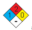
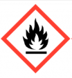

# FDS 14: transcripción documental automática

> Fuente: `FDS EVALUADAS/FDS 2018/FDS 14 -PINTURA-ACRILICA-PARA-TRÁFICO.pdf`
> Páginas PDF: 4
> SHA256 original: 933b06dc22e069880908acd71f19627ab6b82345eec974fd9b4561c9a64dad87
> Precaución: transcripción no validada de manera integral; no usar resultados de seguridad sin contrastar la ficha PDF original.

---

## Página PDF 1

HOJA DE SEGURIDAD
2
PINTURA ACRÍLICA PARA TRÁFICO
Página 1 de
039
1
0
4

### 1. IDENTIFICACION DEL FABRICANTE Y DE LA SUSTANCIA QUÍMICA

Empresa:
TECNIDECOR S.A.S
Nit:
900112215-2
Pbx:
444 49 44
Nombre del Producto:
PINTURA ACRILICA PARA TRÁFICO
Código del producto:
039
Sinónimos:
N/A
Fórmula:
Base de co-polímero estireno-acrílica
Número UN:
1263
Clase UN:
3
Fecha de actualización:
Octubre de 2018

### 2. COMPOSICIÓN, INFORMACIÓN SOBRE INGREDIENTES

| COMPOSICIÓN | % PESO | NOMBRE | N° CAS (transcripción literal) |
|---|---:|---|---|
| Vehículo | 1 9.60 | Resina Acrílica | No Determinado |
| Pigmentos | 53.00 | Dióxido de Titanio | 13463-67-7 |
|  |  | Bentone | SD2 14808-60-7 |
|  |  | Talco | 14807-96-6 |
| Solventes | 12.83 | Xileno | 1330-20-7 9.45 |
|  |  | Acetona | 67-64-1 5.12 |
|  |  | Tolueno | 108-88-3 |

> **Control de fidelidad:** se respetan literalmente los datos visibles y su agrupación en la página original. Los valores `9.45` y `5.12` aparecen a continuación de los CAS dentro de la columna derecha del PDF; no se asignan a una concentración sin evidencia inequívoca. El valor `1 9.60` también se conserva literalmente. Revisión humana necesaria para interpretar esos tres valores sin modificar el original.

### 3. IDENTIFICACION DE RIESGOS

 Liquido combustible. Irritante. Se puede incendiar fácilmente por calor, chispas o llamas. Los vapores pueden formar
mezclas explosivas con el aire. Los vapores pueden causar mareos o sofocación. La inhalación o el contacto con el
material pueden irritar o quemar la piel y los ojos.
 El producto puede encenderse por llamas, exceso de calor, chispas o carga electrostática.
 Los solventes pueden provocar irritaciones en los ojos, piel y vías respiratorias. La inhalación prolongada de vapores
puede producir vértigos, somnolencia o incluso pérdida de la conciencia. Los solventes son nocivos para la salud si se
ingieren.
 En caso de incendio los envases explotarán, aumentando la intensidad de las llamas.
SALUD
1
INFLAMABLE
2
PELIGRO FÍSICO
0
PROTECCIÓN PERSONAL
.

### 4. PRIMEROS AUXILIOS

INHALACION DE VAPORES: Sacar a la víctima de la zona de peligro. En caso de paro respiratorio, practicar la respiración
artificial. Llamar a un médico.
CONTACTO CON LA PIEL: Lavar inmediatamente con agua. Si persiste la irritación, llamar a un médico. Cambiar la ropa
contaminada. Lavarla antes de volver a utilizarla.
CONTACTO CON LOS OJOS: Lavar con bastante agua manteniendo los párpados abiertos. Acto seguido, consultar al
médico (oculista).
INGESTION: No provocar vómito. Dar agua abundante. Nunca se administrará nada en la boca de una persona que haya
perdido la conciencia. Llamar inmediatamente al médico.

#### Imagen incrustada — PDF página 1, aparición 1

> Sección aproximada: 4; posición: (95.0, 50.0, 212.0, 69.6). Verificar contenido visual con PDF.

#### Imagen incrustada — PDF página 1, aparición 2

> Sección aproximada: 4; posición: (215.6, 494.6, 281.6, 557.6). Verificar contenido visual con PDF.

#### Imagen incrustada — PDF página 1, aparición 3

> Sección aproximada: 4; posición: (296.4, 494.6, 357.8, 561.4). Verificar contenido visual con PDF.

#### Imagen incrustada — PDF página 1, aparición 4

> Sección aproximada: 4; posición: (371.0, 494.6, 434.0, 560.0). Verificar contenido visual con PDF.

#### Imagen incrustada — PDF página 1, aparición 5

> Sección aproximada: 4; posición: (62.4, 539.8, 83.6, 561.0). Verificar contenido visual con PDF.

#### Imagen incrustada — PDF página 1, aparición 6

> Sección aproximada: 4; posición: (86.0, 539.8, 107.0, 561.0). Verificar contenido visual con PDF.

#### Imagen incrustada — PDF página 1, aparición 7

> Sección aproximada: 4; posición: (109.6, 540.0, 130.2, 560.4). Verificar contenido visual con PDF.

#### Imagen incrustada — PDF página 1, aparición 8

> Sección aproximada: 4; posición: (56.6, 95.2, 75.2, 117.2). Verificar contenido visual con PDF.

#### Imagen incrustada — PDF página 1, aparición 9

> Sección aproximada: 4; posición: (56.6, 242.0, 76.6, 261.4). Verificar contenido visual con PDF.

#### Imagen incrustada — PDF página 1, aparición 10

> Sección aproximada: 4; posición: (56.6, 368.2, 80.0, 388.2). Verificar contenido visual con PDF.

#### Imagen incrustada — PDF página 1, aparición 11

> Sección aproximada: 4; posición: (56.6, 583.2, 84.0, 606.8). Verificar contenido visual con PDF.

---

## Página PDF 2

HOJA DE SEGURIDAD
2
PINTURA ACRÍLICA PARA TRÁFICO
Página 2 de
039
1
0
4

### 5. COMBATE DE INCENDIOS

MEDIOS DE EXTINCIÓN: Arena, espuma o producto extintor seco tipo ABC.
PELIGROS DE EXPOSICION: Proteger contra llamas de soplete (llamas tipo dardo). Las tapas de los envases pueden salir
despedidas con violencia. - Los productos al arder pueden desprender vapores tóxicos. Las personas que hayan inhalado
dichos vapores, se tenderán en posición horizontal y se mantendrán en reposo. Avisar de inmediato al médico.
PROTECCION DE LOS BOMBEROS: Los bomberos deben trabajar orientados en la dirección por donde sopla el viento y
contar con aparatos de protección respiratoria y trajes de seguridad impermeables para estar protegidos contra vapores
tóxicos. - Una vez extinguido el incendio, tomar las precauciones del caso para evitar que se reinicie el fuego..

### 6. LIBERACIONES ACCIDENTALES


Evitar fuentes que generen chispas. No fumar.

Procurar que haya ventilación y extracción suficiente.

Evitar el contacto con la piel y los ojos.

Evitar la inhalación de vapores por tiempo prolongado.

Utilizar equipo y ropa de seguridad apropiados.

### 7.MANEJO Y ALMACENAJE

 MANIPULACION:
Evitar el contacto con álcalis, sustancias cáusticas, aminas e inflamables.
Procurar que exista ventilación y extracción suficiente.
Proteger de las llamas, calor, sacudidas, golpes, frotes, chispas y cargas electrostáticas.
No fumar en las inmediaciones. Se debe prohibir fumar en los recintos en los que se encuentre el producto; colgar carteles de
“NO FUMAR”.
Mantener los recipientes herméticamente cerrados, cuando no están en uso.
Transportar los envases con cuidado, evitando la exposición prolongada bajo el sol.
CONDICIONES DE ALMACENAMIENTO:
Almacenar dentro de los envases originales, en recintos frescos, secos y suficientemente ventilados; la temperatura
recomendada para el almacenaje es <= 25°C.
Proteger del calor, llamas, otros focos de chispas y de los rayos solares directos.
No fumar en las inmediaciones. Se debe prohibir fumar en los recintos en los que se encuentre el producto; colgar carteles de
“NO FUMAR”.
El producto no debe almacenarse junto con materiales como álcalis, sustancias cáusticas, aminas o sustancias oxidantes.
El material que entró en el almacén en primer lugar, deberá ser también el primero en salir y utilizarse. Llevar control de las
fechas de fabricación, las que figuran en las etiquetas de los envases. No dejar almacenado el producto por más de un año.
No abrir ni vaciar los envases dentro del almacén.

### 8. CONTROLES DE EXPOSICIÓN, PROTECCIÓN PERSONAL

MEDIDAS DE INGENIERIA: Asegurarse que exista ventilación suficiente en el área. Controlar las concentraciones de vapor
en el aire circundante al puesto de trabajo.
PROTECCION RESPIRATORIA: Usar dispositivo de protección respiratoria con filtro de partículas (NIOSH 3M 7090) y de
gases (NIOSH 3M 7252).
PROTECCION MANUAL: Usar guantes de seguridad anti estáticos, no combustibles.
PROTECCION DE LOS OJOS: Usar gafas de seguridad.
PROTECCION CORPORAL: Usar prendas de seguridad.

### 9. PROPIEDADES FÍSICAS Y QUÍMICAS.

Estado
Físico: Líquido
Color:
Varios colores
Olor:
Irritante

#### Imagen incrustada — PDF página 2, aparición 1

> Sección aproximada: 9; posición: (95.0, 50.0, 212.0, 69.6). Verificar contenido visual con PDF.

#### Imagen incrustada — PDF página 2, aparición 2

> Sección aproximada: 9; posición: (64.0, 100.2, 84.4, 117.6). Verificar contenido visual con PDF.

#### Imagen incrustada — PDF página 2, aparición 3

> Sección aproximada: 9; posición: (56.6, 211.4, 82.4, 233.2). Verificar contenido visual con PDF.

#### Imagen incrustada — PDF página 2, aparición 4

> Sección aproximada: 9; posición: (61.8, 319.6, 87.4, 339.2). Verificar contenido visual con PDF.

#### Imagen incrustada — PDF página 2, aparición 5

> Sección aproximada: 9; posición: (60.4, 557.4, 83.2, 580.6). Verificar contenido visual con PDF.

#### Imagen incrustada — PDF página 2, aparición 6

> Sección aproximada: 9; posición: (61.8, 674.4, 87.8, 690.8). Verificar contenido visual con PDF.

---

## Página PDF 3

HOJA DE SEGURIDAD
2
PINTURA ACRÍLICA PARA TRÁFICO
Página 3 de
039
1
0
4
Solubilidad en agua:
Insoluble
Punto de inflamación:
30°C
Densidad:
5.50 kg/gln
Gravedad Específica:
1.453
Sólidos en volumen:
53.0 %
PVC:
52.70 %.10

### 10. ESTABILIDAD Y REACTIVIDAD

ESTABILIDAD: Estable bajo condición normal y manipulada de manera adecuada (en almacén la temperatura no debe
sobrepasar los 25°C).
CONDICIONES A EVITAR: Evitar el calor, golpes y fricción.
MATERIALES A EVITAR: Contacto de los envases con álcalis, sustancias cáusticas, aminas o sustancias oxidantes.
PRODUCTOS DE DESCOMPOSICIÓN PELIGROSOS: Los productos de descomposición pueden ser monóxido de carbono
(CO), dióxido de carbono (CO2), óxidos de nitrógeno y otros vapores potencialmente tóxicos.

### 11. INFORMACIÓN TOXICOLÓGICA.

El producto es tóxico. La toxicidad del producto depende de la emanación de solventes durante la preparación y aplicación
del mismo.
Alta concentración de vapor produce vértigo, mareo, desvanecimiento, dolor de cabeza y dificultad de la respiración.

### 12. INFORMACIÓN ECOLÓGICA.

MOVILIDAD: Producto volátil, inflamable, tóxico, insoluble en agua.
DEGRADABILIDAD: Producto no biodegradable.

### 13. CONSIDERACIONES SOBRE LA DISPOSICIÓN.

ELIMINACION DE EMBALAJE: La eliminación de residuos debe realizarse con arreglo a la legislación nacional y a las
disposiciones de protección del medio ambiente.
NOTA: Se requiere la atención del usuario hacia la posible existencia de regulaciones regionales o nacionales vinculadas con
esta materia.

### 14. INFORMACIÓN SOBRE EL TRANSPORTE.

ADR / RID: Class 3.1.2
IMDG CODE: Class 3.1.2
ICAO / IATA DGR: Class 3.1.2
CLASE: 3
No. ONU: 1263

### 15. INFORMACIÓN SOBRE REGLAMENTACIÓN.

Para el transporte de esta sustancia dentro del territorio nacional se deben cumplir los requisitos técnicos y de seguridad para
el manejo y transporte de mercancías peligrosas por carretera en vehículos automotores, estipulados en el Decreto 1079 de
2015, Capítulo7, Sección 8.
NOTA: La información proporcionada cubre lo descrito en la hoja de seguridad. Se requiere la atención del usuario hacia la
existencia de disposiciones complementarias. Consultar las regulaciones nacionales, internacionales y locales aplicables.

### 16. OTRA INFORMACIÓN.

#### Imagen incrustada — PDF página 3, aparición 1

> Sección aproximada: 16; posición: (95.0, 50.0, 212.0, 69.6). Verificar contenido visual con PDF.

#### Imagen incrustada — PDF página 3, aparición 2

> Sección aproximada: 16; posición: (61.8, 167.8, 81.4, 189.0). Verificar contenido visual con PDF.

#### Imagen incrustada — PDF página 3, aparición 3

> Sección aproximada: 16; posición: (56.6, 271.8, 81.0, 295.0). Verificar contenido visual con PDF.

#### Imagen incrustada — PDF página 3, aparición 4

> Sección aproximada: 16; posición: (56.6, 346.8, 81.0, 369.4). Verificar contenido visual con PDF.

#### Imagen incrustada — PDF página 3, aparición 5

> Sección aproximada: 16; posición: (61.8, 410.8, 85.0, 433.2). Verificar contenido visual con PDF.

#### Imagen incrustada — PDF página 3, aparición 6

> Sección aproximada: 16; posición: (56.6, 495.4, 78.8, 517.8). Verificar contenido visual con PDF.

#### Imagen incrustada — PDF página 3, aparición 7

> Sección aproximada: 16; posición: (61.8, 591.0, 87.0, 612.2). Verificar contenido visual con PDF.

#### Imagen incrustada — PDF página 3, aparición 8

> Sección aproximada: 16; posición: (61.8, 695.0, 84.2, 714.0). Verificar contenido visual con PDF.

---

## Página PDF 4

HOJA DE SEGURIDAD
2
PINTURA ACRÍLICA PARA TRÁFICO
Página 4 de
039
1
0
4
Esta hoja de seguridad tiene como fin sólo a brindar una guía basada en la Norma NTC 4435. Para el manejo del material con
la precaución apropiada Las personas que reciban la información deben ejercer su propio criterio para determinar la
conveniencia del uso de este producto para un fin específico. TECNIDECOR S.A.S no se hace responsable de ningún daño
causado a propiedades o a personas por el uso inadecuado de nuestros productos, ya que no conocemos la manipulación ni
las precauciones que cada cliente tiene en el almacenamiento.

#### Imagen incrustada — PDF página 4, aparición 1

> Sección aproximada: 16; posición: (95.0, 50.0, 212.0, 69.6). Verificar contenido visual con PDF.

