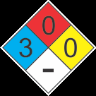
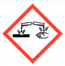
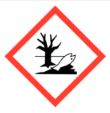

# FDS 17: transcripción documental automática

> Fuente: `FDS EVALUADAS/FDS 2018/FDS 17 - inmunizante-universal.pdf`
> Páginas PDF: 4
> SHA256 original: 2e1d1b6d9524d9ca51f8d623057b758b281c865fe461d451b210b58844307453
> Precaución: transcripción no validada de manera integral; no usar resultados de seguridad sin contrastar la ficha PDF original.

---

## Página PDF 1

HOJA DE SEGURIDAD
0
INMUNIZANTE UNIVERSAL
136
3
0
Página 1 de
4

### 1. IDENTIFICACION DEL FABRICANTE Y DE LA SUBSTANCIA QUIMICA

Empresa:
TECNIDECOR S.A.S
Nit:
900112215-2
Pbx:
444 49 44
Nombre del Producto:
INMUNIZANTE UNIVERSAL
Código del producto:
136
Sinónimos:
CCA
Fórmula:
CuO + As2O5 + CrO3.
Número UN:
2922
Clase UN:

### 3-0-0

Fecha de actualización:
Octubre de 2018

### 2. COMPOSICION, INFORMACION SOBRE INGREDIENTES

Nombre Químico :
Oxido de cobre
Oxido de arsénico
Óxido de cromo
Formula Química :
CuO + As2O5 + CrO3
Nº CAS :
1317 38 0
12044 50 7
1333 82 - 0

### 3. IDENTIFICACION DE RIESGOS

Clasificación de Riesgo : 6.1
Inhalación: Puede provocar irritación a las vías respiratorias
Contacto con la piel: Producto altamente soluble en agua, por lo que es fácilmente absorbido por la piel, además puede
provocar quemaduras severas y ulceración
Contacto con los ojos: Puede provocar irritación y severas quemaduras y ulceraciones oculares
Ingestión: Puede producir quemaduras serias en todo el sistema gastrointestinal, problemas respiratorios y digestivos Efectos
de una sobreexposición crónica (largo plazo) : Puede provocar anemias, neuropatia, reducción de la circulación periférica,
problemas cardiovasculares y sistema linfático
Condiciones médicas que se verán agravadas con la exposición al producto: Dermatitis, problemas respiratorios
Peligros para el medio ambiente: Producto altamente tóxico para peces, mamíferos, aves e insectos
Peligros especiales del producto: Es un producto de características oxidantes, aunque no es combustible, los vapores
ocasionados por la elevación de temperatura pueden ser muy dañinos para la salud
SALUD
3
INFLAMABLE
0
PELIGRO FÍSICO
0
PROTECCIOÓN PERSONAL

### 4. PRIMEROS AUXILIOS

En caso de contacto accidental con el producto, proceder de acuerdo con
Inhalación : Llevar a la persona afectada a una zona libre
Contacto con la piel : Debe procederse a un lavado inmediato con abundante agua y jabón. Pedir asistencia médica
Contacto con los ojos : Lavar con abundante agua corriente durante a lo menos quince minutos. Pedir asistencia médica
Ingestión : En caso de ingesta accidental debe procederse a la ingesta de abundante leche, clara de huevo o solución de
gelatina. Si no se dispone de estos elementos, beba agua en abundancia, induzca al vomito con salmuera. Llamar de inmediato
a un médico

#### Imagen incrustada — PDF página 1, aparición 1

> Sección aproximada: 4; posición: (95.8, 36.0, 192.2, 84.4). Verificar contenido visual con PDF.

#### Imagen incrustada — PDF página 1, aparición 2

> Sección aproximada: 4; posición: (200.2, 536.8, 263.2, 600.0). Verificar contenido visual con PDF.

#### Imagen incrustada — PDF página 1, aparición 3

> Sección aproximada: 4; posición: (274.0, 536.8, 334.8, 598.2). Verificar contenido visual con PDF.

#### Imagen incrustada — PDF página 1, aparición 4

> Sección aproximada: 4; posición: (346.4, 536.8, 406.6, 598.2). Verificar contenido visual con PDF.

#### Imagen incrustada — PDF página 1, aparición 5

> Sección aproximada: 4; posición: (417.4, 536.8, 478.6, 599.2). Verificar contenido visual con PDF.

#### Imagen incrustada — PDF página 1, aparición 6

> Sección aproximada: 4; posición: (489.6, 536.8, 549.4, 598.2). Verificar contenido visual con PDF.

#### Imagen incrustada — PDF página 1, aparición 7

> Sección aproximada: 4; posición: (60.2, 582.0, 81.6, 603.6). Verificar contenido visual con PDF.

#### Imagen incrustada — PDF página 1, aparición 8

> Sección aproximada: 4; posición: (84.2, 582.6, 105.2, 603.6). Verificar contenido visual con PDF.

#### Imagen incrustada — PDF página 1, aparición 9

> Sección aproximada: 4; posición: (105.2, 582.6, 126.2, 603.6). Verificar contenido visual con PDF.

#### Imagen incrustada — PDF página 1, aparición 10

> Sección aproximada: 4; posición: (128.8, 582.4, 150.2, 603.6). Verificar contenido visual con PDF.

#### Imagen incrustada — PDF página 1, aparición 11

> Sección aproximada: 4; posición: (56.6, 98.4, 75.2, 120.4). Verificar contenido visual con PDF.

#### Imagen incrustada — PDF página 1, aparición 12

> Sección aproximada: 4; posición: (56.6, 245.2, 76.6, 264.6). Verificar contenido visual con PDF.

#### Imagen incrustada — PDF página 1, aparición 13

> Sección aproximada: 4; posición: (56.6, 361.2, 80.0, 381.2). Verificar contenido visual con PDF.

#### Imagen incrustada — PDF página 1, aparición 14

> Sección aproximada: 4; posición: (56.6, 625.4, 84.0, 649.0). Verificar contenido visual con PDF.

---

## Página PDF 2

HOJA DE SEGURIDAD
0
INMUNIZANTE UNIVERSAL
136
3
0
Página 2 de
4
Notas para el médico tratante : Este producto es un estimulante metabólico que provoca hipertermia y el paciente debe ser
tratado de acuerdo a los síntomas.

### 5. COMBATE DE INCENDIOS

Agentes de Extinción : La emergencia de incendio puede controlarse con cualquier medio de extinción, permitir el enfriamiento
de los envases
Procedimientos especiales para combatir el fuego : No es un producto combustible ni explosivo, pero se debe evitar el contacto
con fuentes de calor, ya que a temperaturas altas este puede descomponer gases que pueden ser tóxicos
Equipos de protección personal para el combate del fuego : La ropa debe ser la adecuada a dicha emergencia, usar mascara
full face, o bien un respirador autónomo

### 6. LIBERACIONES ACCIDENTALES

Medidas de Emergencias a tomar si hay derrames del material : Evacuar el lugar y evitar la inhalación del producto.
En caso de derrame accidental se recomienda el uso de 45 kg de cal o 175 kg de cemento seco por cada 100 kg
Equipo de protección personal para atacar la emergencia : Ropa adecuada a la emergencia, y utilizar máscara full face o bien
un respirador autónomo
Precauciones a tomar para evitar daños al ambiente : Los empaques no deben ser abiertos durante el almacenaje sino al
momento de ser empleados.
El preservante debe guardarse en lugares frescos, protegidos de la lluvia y lejos de toda fuente de calor.
Nunca eliminar restos de producto en lagos, ríos o alguna fuente de agua.
Métodos de limpieza : Utilizar barrido luego previo mezclar con cal o cemento
Método de eliminación de desechos :
Utilizar algún vertedero autorizado o bien hablar con su proveedor

### 7.MANEJO Y ALMACENAJE

Recomendaciones Técnicas: Es un preservante a base de óxidos diluidos de cromo, cobre y arsénico que se usa
exclusivamente en la impregnación a presión y vacío de productos forestales tales como; madera de construcción, postes
eléctricos, estacas de uso agrícola, construcciones marinas, pilotes.
Precauciones a tomar: Los empaques no deben ser abiertos durante el almacenaje sino al momento de ser empleados
Recomendaciones sobre manipulación Segura, específicas :
Nunca golpear o ejercer presión sobres los envases del producto, evitar sus salpicaduras
Condiciones de almacenamiento : El preservante debe guardarse en lugares frescos, protegidos de la lluvia y lejos de toda
fuente de calor
Embalaje recomendados y No adecuados : Envases plásticos. Materiales metálicos son no recomendados por ser fácilmente
oxidables, es posible utilizar aquellos que posean recubrimiento tipo epóxico o similar

### 8. CONTROLES DE EXPOSICION, PROTECCION PERSONAL

Medidas para reducir la posibilidad de exposición : Ropa que cubra la totalidad del cuerpo incluyendo brazos y piernas en
forma completa, cuyo material sea impermeable al producto
Límites permisibles ponderado (LPP) y Absoluto (LPA) : 0.06 mg/m3 ; 0.03mg/m3
Protección respiratoria : Utilizar mascarilla tipo full face o bien un respirador autónomo
Guantes de protección : Guante de plástico o caucho
Protección de la vista : Lentes que permitan completa protección a la vista
Otros equipos de protección : Delantal de caucho y botas impermeable al producto
Ventilación : Trabajar en zonas que permitan la libre circulación del producto y en caso contrario utilizar ventilación forzada

### 9. PROPIEDADES FISICAS Y QUIMICAS.

Estado físico :
Líquido
Apariencia y olor : Oleoso,
color
café verdoso
Concentración :
60 % pH :

#### Imagen incrustada — PDF página 2, aparición 1

> Sección aproximada: 9; posición: (95.8, 36.0, 192.2, 84.4). Verificar contenido visual con PDF.

#### Imagen incrustada — PDF página 2, aparición 2

> Sección aproximada: 9; posición: (64.0, 134.4, 84.4, 152.0). Verificar contenido visual con PDF.

#### Imagen incrustada — PDF página 2, aparición 3

> Sección aproximada: 9; posición: (56.6, 235.2, 82.4, 257.2). Verificar contenido visual con PDF.

#### Imagen incrustada — PDF página 2, aparición 4

> Sección aproximada: 9; posición: (61.8, 392.2, 87.4, 412.0). Verificar contenido visual con PDF.

#### Imagen incrustada — PDF página 2, aparición 5

> Sección aproximada: 9; posición: (60.4, 536.2, 83.2, 559.4). Verificar contenido visual con PDF.

#### Imagen incrustada — PDF página 2, aparición 6

> Sección aproximada: 9; posición: (61.8, 663.6, 87.8, 680.0). Verificar contenido visual con PDF.

---

## Página PDF 3

HOJA DE SEGURIDAD
0
INMUNIZANTE UNIVERSAL
136
3
0
Página 3 de
4
Temperatura de
descomposición :
> 60 ºC
Punto de inflamación :
N. A.
Temperatura de
autoignición :
N.A.
Propiedades explosivas : No posee Velocidad de propagación de la llama:N. A.
Presión de vapor a 20ºC :  Sin información
Densidad de vapor :
N.A.
Densidad a 20ºC :
1.85 g/ml
Solubilidad en agua y
otros :
Totalmente soluble en agua. Insoluble en solventes orgánicos

### 10. ESTABILIDAD Y REACTIVIDAD

Estabilidad :Estable, pero a temperaturas sobre 60 º pierde sus propiedades de mezcla homogénea.
Condiciones que deben evitarse :Fuentes de calor, intemperie. Incompatibilidad (materiales que deben evitarse) :
Incompatible con metales, álcalis
Productos peligrosos de la descomposición :No posee Productos peligrosos de la combustión :Los que posee la mezcla
Polimerización peligrosa :No tiene

### 11. INFORMACION TOXICOLOGICA.

Toxicidad aguda : Oral LD50 : 50 mg/kg (ratas adultas)
Toxicidad crónica o de largo plazo :
Dérmica LD50 : 450 mg/kg (roedores)
Efectos locales : Daños al corazón, hígado y riñones
Sensibilización alérgica : Dermatitis, verrugas y ulceraciones

### 12. INFORMACION ECOLOGICA.

Inestabilidad : Producto estable en el tiempo
Persistencia / Degrabilidad : Producto que persiste en el tiempo y no se degrada fácilmente
Bio-acumulación : Producto que se elimina por las fecas, dependiendo de la concentración y el metabolismo de cada persona
Efectos sobre el ambiente : Producto tóxico para peces, mamíferos, aves e insectos

### 13. CONSIDERACIONES SOBRE LA DISPOSICION.

Método de eliminación del producto en los residuos : Usar algún vertedero autorizado
Los envases vacíos deben ser triple lavados con agua. Las aguas de lavado pueden utilizarse para la dilución del producto.
Los envases se deben destruir para evitar su utilización para otros fines y comercializados como chatarra para reciclaje.

### 14. INFORMACION SOBRE EL TRANSPORTE.

Veneno, No almacenar junto a alimentos
Nº UN : 2922
Grupo de embalaje II

### 15. INFORMACION SOBRE REGLAMENTACION.

Algunos de sus componentes estan regulados para el transporte, se debe dar cumplimiento al Decreto 1609 de 2002.
Ministerio de Transporte.
NOTA: La información proporcionada cubre lo descrito en la hoja de seguridad. Se requiere la atención del usuario hacia la
existencia de disposiciones complementarias. Consultar las regulaciones nacionales, internacionales y locales aplicables.

#### Imagen incrustada — PDF página 3, aparición 1

> Sección aproximada: 15; posición: (95.8, 36.0, 192.2, 84.4). Verificar contenido visual con PDF.

#### Imagen incrustada — PDF página 3, aparición 2

> Sección aproximada: 15; posición: (61.8, 222.6, 81.4, 244.0). Verificar contenido visual con PDF.

#### Imagen incrustada — PDF página 3, aparición 3

> Sección aproximada: 15; posición: (56.6, 316.4, 81.0, 339.6). Verificar contenido visual con PDF.

#### Imagen incrustada — PDF página 3, aparición 4

> Sección aproximada: 15; posición: (56.6, 412.0, 81.0, 434.8). Verificar contenido visual con PDF.

#### Imagen incrustada — PDF página 3, aparición 5

> Sección aproximada: 15; posición: (61.8, 486.4, 85.0, 508.8). Verificar contenido visual con PDF.

#### Imagen incrustada — PDF página 3, aparición 6

> Sección aproximada: 15; posición: (56.6, 560.8, 78.8, 583.2). Verificar contenido visual con PDF.

#### Imagen incrustada — PDF página 3, aparición 7

> Sección aproximada: 15; posición: (61.8, 635.6, 87.0, 656.8). Verificar contenido visual con PDF.

---

## Página PDF 4

HOJA DE SEGURIDAD
0
INMUNIZANTE UNIVERSAL
136
3
0
Página 4 de
4

### 16. OTRA INFORMACION.

Esta hoja de seguridad tiene como fin sólo a brindar una guía basada en la Norma NTC 4435. Para el manejo del material con
la precaución apropiada Las personas que reciban la información deben ejercer su propio criterio para determinar la
conveniencia del uso de este producto para un fin específico. TECNIDECOR S.A.S no se hace responsable de ningún daño
causado a propiedades o a personas por el uso inadecuado de nuestros productos, ya que no conocemos la manipulación ni
las precauciones que cada cliente tiene en el almacenamiento.

#### Imagen incrustada — PDF página 4, aparición 1

> Sección aproximada: 16; posición: (95.8, 36.0, 192.2, 84.4). Verificar contenido visual con PDF.

#### Imagen incrustada — PDF página 4, aparición 2

> Sección aproximada: 16; posición: (61.8, 98.4, 84.2, 117.6). Verificar contenido visual con PDF.

