# FDS 31: transcripción documental automática

> Fuente: `FDS EVALUADAS/FDS 2019/FDS 31 - 407141521 - RECUBRIMIENTO ANTIGRAFFITI - CORONA .pdf`
> Páginas PDF: 11
> SHA256 original: 91f7dec3fba5aeb56208cd8e6a4e3678a7922380cd396e014fdc13486906da16
> Precaución: transcripción no validada de manera integral; no usar resultados de seguridad sin contrastar la ficha PDF original.

---

## Página PDF 1

Ficha de datos de seguridad
según Decreto 1496 de 2018
407141521 - RECUBRIMIENTO ANTIGRAFFITI

### SECCIÓN 1: IDENTIFICACIÓN DEL PRODUCTO

1.1
Identificador SGA del producto:
407141521 - RECUBRIMIENTO ANTIGRAFFITI
1.2
Uso recomendado del producto químico y restricciones:
Usos pertinentes: Recubrimiento, protección y decoración para sustratos al exterior.
Usos desaconsejados: Todo aquel uso no especificado en este epígrafe ni en el epígrafe 7.3
1.3
Datos sobre el proveedor:
CORLANC S.A.S.
Carrera 48 N° 72 sur 01 Avenida Las Vegas
055450 Sabaneta - Antioquia - Colombia
Tfno.: +57-4-3787800
materialesypinturascorona@corona.com.co
https://www.corona.co
1.4
Número de teléfono para emergencias:
CISTEMA - ARL SURA 018000511414 - 0314055911

### SECCIÓN 2: IDENTIFICACIÓN DEL PELIGRO O PELIGROS

Indicaciones de peligro:
Carc. 1B: H350 - Puede provocar cáncer
Irrit. oc. 2: H319 - Provoca irritación ocular grave
Liq. Infl. 3: H226 - Líquido y vapores inflamables
Muta. 1B: H340 - Puede provocar defectos genéticos
Sens. Cut. 1: H317 - Puede provocar una reacción cutánea alérgica
Tox. Agud. 5: H313 - Puede ser nocivo en contacto con la piel
Tox. Asp. 1: H304 - Puede ser mortal en caso de ingestión y de penetración en las vías respiratorias
Consejos de prudencia:
- CONTINÚA EN LA SIGUIENTE PÁGINA -
Emisión: 25/07/2019            Versión: 1
Página 1/11

#### Imagen incrustada — PDF página 1, aparición 1

> Sección aproximada: 2; posición: (36.0, 306.0, 559.3, 346.1). Verificar contenido visual con PDF.

#### Imagen incrustada — PDF página 1, aparición 2

> Sección aproximada: 2; posición: (0.0, 346.1, 595.0, 407.4). Verificar contenido visual con PDF.

#### Imagen incrustada — PDF página 1, aparición 3

> Sección aproximada: 2; posición: (0.0, 407.4, 595.0, 497.3). Verificar contenido visual con PDF.

#### Imagen incrustada — PDF página 1, aparición 4

> Sección aproximada: 2; posición: (36.0, 497.3, 559.3, 508.8). Verificar contenido visual con PDF.

#### Imagen incrustada — PDF página 1, aparición 5
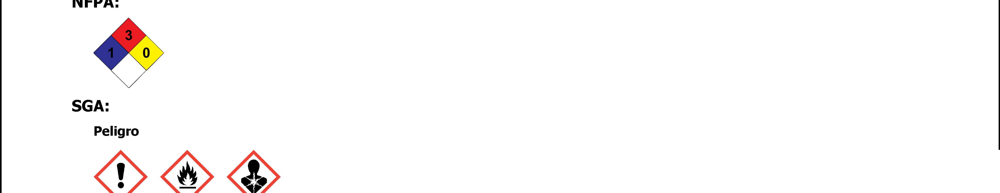
> Sección aproximada: 2; posición: (36.0, 508.8, 559.3, 610.2). Verificar contenido visual con PDF.

#### Imagen incrustada — PDF página 1, aparición 6

> Sección aproximada: 2; posición: (36.0, 610.2, 559.3, 621.6). Verificar contenido visual con PDF.

#### Imagen incrustada — PDF página 1, aparición 7
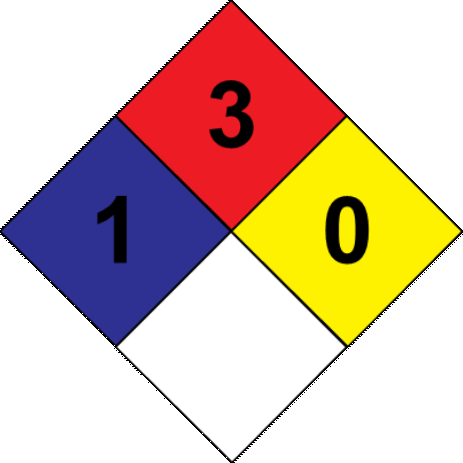
> Sección aproximada: 2; posición: (503.8, 36.0, 559.3, 91.6). Verificar contenido visual con PDF.

#### Imagen incrustada — PDF página 1, aparición 8

> Sección aproximada: 2; posición: (36.0, 51.6, 132.7, 76.0). Verificar contenido visual con PDF.

---

## Página PDF 2

Ficha de datos de seguridad
según Decreto 1496 de 2018
407141521 - RECUBRIMIENTO ANTIGRAFFITI

### SECCIÓN 2: IDENTIFICACIÓN DEL PELIGRO O PELIGROS (continúa)

P101: Si se necesita consultar a un médico, tener a mano el recipiente o la etiqueta del producto
P102: Mantener fuera del alcance de los niños
P210: Mantener alejado del calor, superficies calientes, chispas llamas al descubierto y otras fuentes de ignición. No fumar
P264: Lavarse cuidadosamente después de la manipulación
P280: Usar guantes/ropa de protección/equipo de protección para los ojos/la cara
P305+P351+P338: EN CASO DE CONTACTO CON LOS OJOS: Enjuagar con agua cuidadosamente durante varios minutos.
Quitar las lentes de contacto cuando estén presentes y pueda hacerse con facilidad. Proseguir con el lavado
P370+P378: En caso de incendio: Utilizar extintor de polvo ABC para la extinción
P501: Eliminar el contenido/recipiente mediante el sistema de recogida selectiva habilitado en su municipio
Sustancias que contribuyen a la clasificación
N-butil-N-((trietoxisilil)metil)butan-1-amina; Destilados (petróleo), fracción ligera tratada con hidrógeno; Nafta (petróleo),
fracción pesada tratada con hidrógeno; N-(3-(trimetoxisilil)propil)etilenodiamina
2.3
Otros peligros que no conducen a una clasificación:
No relevante

### SECCIÓN 3: COMPOSICIÓN/INFORMACIÓN SOBRE LOS COMPONENTES

**3.1 Sustancias:** No aplicable.  **3.2 Mezclas:** Mezcla acuosa a base de productos químicos para recubrimientos.

**Componentes (tabla transcrita del PDF original, página 2/11):**

| Identificación CAS | Nombre químico | Clasificación indicada en PDF | Concentración |
|---|---|---|---|
| 64742-47-8 | Destilados (petróleo), fracción ligera tratada con hidrógeno | Tox. Asp. 1: H304 - Peligro | 10 - <30 % |
| 64742-48-9 | Nafta (petróleo), fracción pesada tratada con hidrógeno | Carc. 1B: H350; Muta. 1B: H340; Tox. Agud. 5: H313; Tox. Asp. 1: H304 - Peligro | 1 - <10 % |
| 1760-24-3 | N-(3-(trimetoxisilil)propil)etilenodiamina | Les. Oc. 1: H318; Sens. Cut. 1: H317; Tox. Agud. 5: H303 - Peligro | 1 - <10 % |

**Verificación:** cotejo visual contra FDS 31, página 2/11, sección 3. El Markdown anterior omitía las dos primeras filas. Los pictogramas de cada fila permanecen en el PDF y no se interpretan aquí como texto.

Para ampliar información sobre la peligrosidad de la sustancias consultar las secciones 8, 11, 12, 15 y 16. La clasificación respecto
Carcinogenicidad de las sustancias se ha establecido en función de las monografías de la IARC adecuandola al sistema de
clasificación SGA, para información sobre la clasificación IARC consulte la sección 11.

### SECCIÓN 4: PRIMEROS AUXILIOS

4.1
Descripción de los primeros auxilios necesarios:
Los síntomas como consecuencia de una intoxicación pueden presentarse con posterioridad a la exposición, por lo que, en caso
de duda, exposición directa al producto químico o persistencia del malestar solicitar atención médica, mostrándole la FDS de este
producto.
Por inhalación:
Se trata de un producto que no contiene sustancias clasificadas como peligrosas por inhalación, sin embargo, en caso de
síntomas de intoxicación sacar al afectado de la zona de exposición y proporcionarle aire fresco. Solicitar atención médica si los
síntomas se agravan o persisten.
Por contacto con la piel:
Quitar la ropa y los zapatos contaminados, aclarar la piel o duchar al afectado si procede con abundante agua fría y jabón
neutro. En caso de afección importante acudir al médico. Si el producto produce quemaduras o congelación, no se debe quitar la
ropa debido a que podría empeorar la lesión producida si esta se encuentra pegada a la piel. En el caso de formarse ampollas en
la piel, éstas nunca deben reventarse ya que aumentaría el riesgo de infección.
Por contacto con los ojos:
Enjuagar los ojos con abundante agua a temperatura ambiente al menos durante 15 minutos. Evitar que el afectado se frote o
cierre los ojos. En el caso de que el accidentado use lentes de contacto, éstas deben retirarse siempre que no estén pegadas a
los ojos, de otro modo podría producirse un daño adicional. En todos los casos, después del lavado, se debe acudir al médico lo
más rápidamente posible con la FDS del producto.
Por ingestión/aspiración:
- CONTINÚA EN LA SIGUIENTE PÁGINA -
Emisión: 25/07/2019            Versión: 1
Página 2/11

#### Imagen incrustada — PDF página 2, aparición 1

> Sección aproximada: 4; posición: (36.0, 314.8, 559.3, 346.1). Verificar contenido visual con PDF.

#### Imagen incrustada — PDF página 2, aparición 2
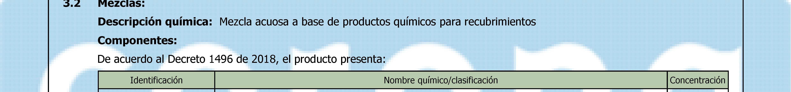
> Sección aproximada: 4; posición: (0.0, 346.1, 595.0, 416.0). Verificar contenido visual con PDF.

#### Imagen incrustada — PDF página 2, aparición 3
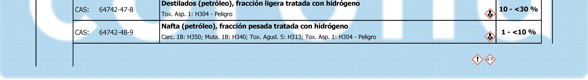
> Sección aproximada: 4; posición: (0.0, 416.0, 595.0, 497.3). Verificar contenido visual con PDF.

#### Imagen incrustada — PDF página 2, aparición 4
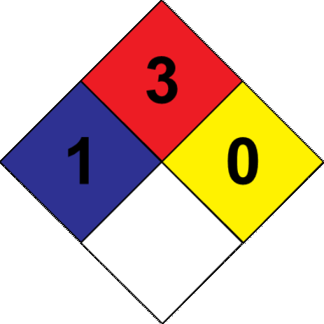
> Sección aproximada: 4; posición: (503.8, 36.0, 559.3, 91.6). Verificar contenido visual con PDF.

#### Imagen incrustada — PDF página 2, aparición 5

> Sección aproximada: 4; posición: (36.0, 51.6, 132.7, 76.0). Verificar contenido visual con PDF.

---

## Página PDF 3

Ficha de datos de seguridad
según Decreto 1496 de 2018
407141521 - RECUBRIMIENTO ANTIGRAFFITI

### SECCIÓN 4: PRIMEROS AUXILIOS (continúa)

Requerir asistencia médica inmediata, mostrándole la FDS de este producto. No inducir al vómito, en el caso de que se produzca
mantener inclinada la cabeza hacia delante para evitar la aspiración. En el caso de pérdida de consciencia no administrar nada
por vía oral hasta la supervisión del médico. Enjuagar la boca y la garganta, ya que existe la posibilidad de que hayan sido
afectadas en la ingestión. Mantener al afectado en reposo.
4.2
Síntomas/efectos más importantes, agudos o retardados:
Los efectos agudos y retardados son los indicados en las secciones 2 y 11.
4.3
Indicación de la necesidad de recibir atención médica inmediata y, en su caso, de tratamiento especial:
No relevante

### SECCIÓN 5: MEDIDAS DE LUCHA CONTRA INCENDIOS

5.1
Medios de extinción apropiados:
Emplear preferentemente extintores de polvo polivalente (polvo ABC), alternativamente utilizar espuma física o extintores de
dióxido de carbono (CO2). NO SE RECOMIENDA emplear agua a chorro como agente de extinción.
5.2
Peligros específicos del producto químico:
Como consecuencia de la combustión o descomposición térmica se generan subproductos de reacción que pueden resultar
altamente tóxicos y, consecuentemente, pueden presentar un riesgo elevado para la salud.
5.3
Medidas especiales que deben tomar los equipos de lucha contra incendios:
En función de la magnitud del incendio puede hacerse necesario el uso de ropa protectora completa y equipo de respiración
autónomo. Disponer de un mínimo de instalaciones de emergencia o elementos de actuación (mantas ignífugas, botiquín
portátil,...).
Disposiciones adicionales:
Actuar conforme el Plan de Emergencia Interior y las Fichas Informativas sobre actuación ante accidentes y otras emergencias.
Suprimir cualquier fuente de ignición. En caso de incendio, refrigerar los recipientes y tanques de almacenamiento de productos
susceptibles a inflamación, explosión o BLEVE como consecuencia de elevadas temperaturas. Evitar el vertido de los productos
empleados en la extinción del incendio al medio acuático.

### SECCIÓN 6: MEDIDAS QUE DEBEN TOMARSE EN CASO DE VERTIDO ACCIDENTAL

6.1
Precauciones personales, equipo protector y procedimiento de emergencia:
Aislar las fugas siempre y cuando no suponga un riesgo adicional para las personas que desempeñen esta función. Evacuar la
zona y mantener a las personas sin protección alejadas. Ante el contacto potencial con el producto derramado se hace obligatorio
el uso de elementos de protección personal (ver sección 8). Evitar de manera prioritaria la formación de mezclas vapor-aire
inflamables, ya sea mediante ventilación o el uso de un agente inertizante. Suprimir cualquier fuente de ignición. Eliminar las
cargas electroestáticas mediante la interconexión de todas las superficies conductoras sobre las que se puede formar electricidad
estática, y estando a su vez el conjunto conectado a tierra.
6.2
Precauciones relativas al medio ambiente:
Producto no clasificado como peligroso para el medioambiente. Mantener el producto alejado de los desagües y de las aguas
superficiales y subterráneas.
6.3
Métodos y materiales para la contención y limpieza de vertidos:
Se recomienda:
Absorber el vertido mediante arena o absorbente inerte y trasladarlo a un lugar seguro. No absorber en serrín u otros
absorbentes combustibles. Para cualquier consideración relativa a la eliminación consultar la sección 13.
6.4
Referencias a otras secciones:
Ver secciones 8 y 13.

### SECCIÓN 7: MANIPULACIÓN Y ALMACENAMIENTO

7.1
Precauciones que se deben tomar para garantizar una manipulación segura:
A.- Precauciones generales
Cumplir con la legislación vigente en materia de prevención de riesgos laborales. Mantener los recipientes herméticamente
cerrados. Controlar los derrames y residuos, eliminándolos con métodos seguros (sección 6). Evitar el vertido libre desde el
recipiente. Mantener orden y limpieza donde se manipulen productos peligrosos.
B.- Recomendaciones técnicas para la prevención de incendios y explosiones.
- CONTINÚA EN LA SIGUIENTE PÁGINA -
Emisión: 25/07/2019            Versión: 1
Página 3/11

#### Imagen incrustada — PDF página 3, aparición 1

> Sección aproximada: 7; posición: (0.0, 346.1, 595.0, 447.5). Verificar contenido visual con PDF.

#### Imagen incrustada — PDF página 3, aparición 2

> Sección aproximada: 7; posición: (0.0, 447.5, 595.0, 497.3). Verificar contenido visual con PDF.

#### Imagen incrustada — PDF página 3, aparición 3

> Sección aproximada: 7; posición: (503.8, 36.0, 559.3, 91.6). Verificar contenido visual con PDF.

#### Imagen incrustada — PDF página 3, aparición 4

> Sección aproximada: 7; posición: (36.0, 51.6, 132.7, 76.0). Verificar contenido visual con PDF.

---

## Página PDF 4

Ficha de datos de seguridad
según Decreto 1496 de 2018
407141521 - RECUBRIMIENTO ANTIGRAFFITI

### SECCIÓN 7: MANIPULACIÓN Y ALMACENAMIENTO (continúa)

Trasvasar en lugares bien ventilados, preferentemente mediante extracción localizada. Controlar totalmente los focos de
ignición (teléfonos móviles, chispas,…) y ventilar en las operaciones de limpieza. Evitar la existencia de atmósferas peligrosas
en el interior de recipientes, aplicando en lo posible sistemas de inertización. Trasvasar a velocidades lentas para evitar la
generación de cargas electroestáticas. Ante la posibilidad de existencia de cargas electroestáticas: asegurar una perfecta
conexión equipotencial, utilizar siempre tomas de tierras, no emplear ropa de trabajo de fibras acrílicas, empleando
preferiblemente ropa de algodón y calzado conductor. Cumplir con los requisitos esenciales de seguridad para equipos  y con
las disposiciones mínimas para la protección de la seguridad y salud de los trabajadores. Consultar la sección 10 sobre
condiciones y materias que deben evitarse.
C.- Recomendaciones técnicas para prevenir riesgos ergonómicos y toxicológicos.
Para control de exposición consultar la sección 8. No comer, beber ni fumar en las zonas de trabajo; lavarse las manos
después de cada utilización, y despojarse de prendas de vestir y equipos de protección contaminados antes de entrar en las
zonas para comer.
D.- Recomendaciones técnicas para prevenir riesgos medioambientales
Se recomienda disponer de material absorbente en las proximidades del producto (ver epígrafe 6.3)
7.2
Condiciones de almacenamiento seguro, incluidas cualesquiera incompatibilidades:
A.- Medidas técnicas de almacenamiento
Tª mínima:
5 ºC
Tª máxima:
30 ºC
Tiempo máximo:
12 meses
B.- Condiciones generales de almacenamiento.
Evitar fuentes de calor, radiación, electricidad estática y el contacto con alimentos. Para información adicional ver epígrafe
10.5
7.3
Usos específicos finales:
Salvo las indicaciones ya especificadas no es preciso realizar ninguna recomendación especial en cuanto a los usos de este
producto.

### SECCIÓN 8: CONTROLES DE EXPOSICIÓN/PROTECCIÓN PERSONAL

Reemplazar cuando se detecte olor o sabor del contaminante en el interior de la
Máscara autofiltrante para gases y vapores
máscara o adaptador facial. Cuando el contaminante no tiene buenas propiedades
de aviso se recomienda el uso de equipos aislantes.
Proteccion obligatoria
del las vias
respiratorias
C.- Protección específica de las manos.
- CONTINÚA EN LA SIGUIENTE PÁGINA -
Emisión: 25/07/2019            Versión: 1
Página 4/11

#### Imagen incrustada — PDF página 4, aparición 1

> Sección aproximada: 8; posición: (0.0, 346.1, 595.0, 447.5). Verificar contenido visual con PDF.

#### Imagen incrustada — PDF página 4, aparición 2
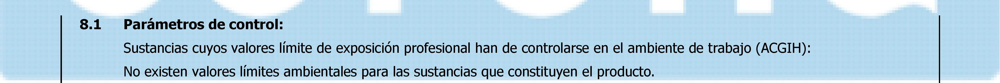
> Sección aproximada: 8; posición: (0.0, 447.5, 595.0, 497.3). Verificar contenido visual con PDF.

#### Imagen incrustada — PDF página 4, aparición 3
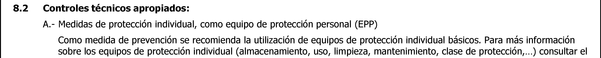
> Sección aproximada: 8; posición: (36.0, 497.3, 559.3, 548.9). Verificar contenido visual con PDF.

#### Imagen incrustada — PDF página 4, aparición 4
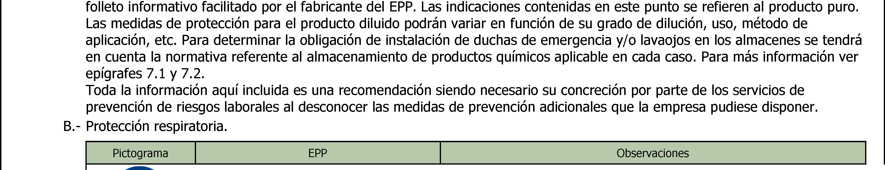
> Sección aproximada: 8; posición: (36.0, 548.9, 559.3, 650.3). Verificar contenido visual con PDF.

#### Imagen incrustada — PDF página 4, aparición 5

> Sección aproximada: 8; posición: (36.0, 650.3, 559.3, 706.6). Verificar contenido visual con PDF.

#### Imagen incrustada — PDF página 4, aparición 6

> Sección aproximada: 8; posición: (503.8, 36.0, 559.3, 91.6). Verificar contenido visual con PDF.

#### Imagen incrustada — PDF página 4, aparición 7

> Sección aproximada: 8; posición: (36.0, 51.6, 132.7, 76.0). Verificar contenido visual con PDF.

---

## Página PDF 5

Ficha de datos de seguridad
según Decreto 1496 de 2018
407141521 - RECUBRIMIENTO ANTIGRAFFITI

### SECCIÓN 8: CONTROLES DE EXPOSICIÓN/PROTECCIÓN PERSONAL (continúa)

ANSI Z358-1
DIN 12 899
ISO 3864-1:2011, ISO 3864-4:2011
ISO 3864-1:2011, ISO 3864-4:2011
Ducha de emergencia
Lavaojos
Controles de la exposición del medio ambiente:
En virtud de la legislación comunitaria de protección del medio ambiente se recomienda evitar el vertido tanto del producto como
de su envase al medio ambiente. Para información adicional ver epígrafe 7.1.D

### SECCIÓN 9: PROPIEDADES FÍSICAS Y QUÍMICAS Y CARACTERÍSTICAS DE SEGURIDAD

9.1
Información de propiedades físicas y químicas básicas:
Para completar la información ver la ficha técnica/hoja de especificaciones del producto.
Aspecto físico:
Estado físico a 20 ºC:
Líquido
Aspecto:
Cristalino
Color:
Incoloro
Olor:
Característico
Umbral olfativo:
No relevante *
Volatilidad:
Temperatura de ebullición a presión atmosférica:
211 ºC
Presión de vapor a 20 ºC:
209 Pa
Presión de vapor a 50 ºC:
1158,31 Pa  (1,16 kPa)
Tasa de evaporación a 20 ºC:
No relevante *
*No relevante debido a la naturaleza del producto, no aportando información característica de su peligrosidad.
- CONTINÚA EN LA SIGUIENTE PÁGINA -
Emisión: 25/07/2019            Versión: 1
Página 5/11

#### Imagen incrustada — PDF página 5, aparición 1
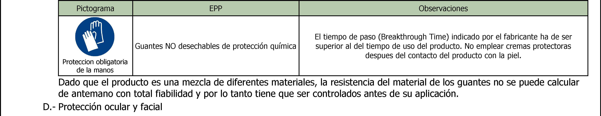
> Sección aproximada: 9; posición: (36.0, 121.9, 559.3, 223.2). Verificar contenido visual con PDF.

#### Imagen incrustada — PDF página 5, aparición 2
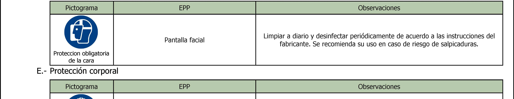
> Sección aproximada: 9; posición: (36.0, 223.2, 559.3, 324.6). Verificar contenido visual con PDF.

#### Imagen incrustada — PDF página 5, aparición 3

> Sección aproximada: 9; posición: (36.0, 324.6, 559.3, 346.1). Verificar contenido visual con PDF.

#### Imagen incrustada — PDF página 5, aparición 4
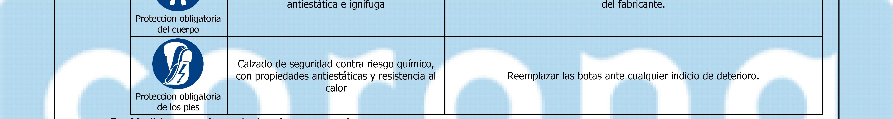
> Sección aproximada: 9; posición: (0.0, 346.1, 595.0, 426.0). Verificar contenido visual con PDF.

#### Imagen incrustada — PDF página 5, aparición 5
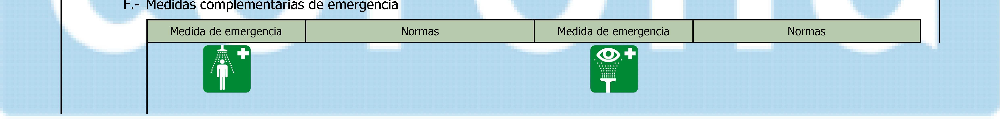
> Sección aproximada: 9; posición: (0.0, 426.0, 595.0, 497.3). Verificar contenido visual con PDF.

#### Imagen incrustada — PDF página 5, aparición 6
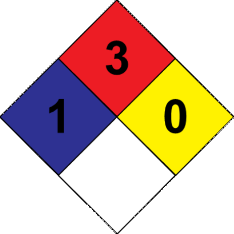
> Sección aproximada: 9; posición: (503.8, 36.0, 559.3, 91.6). Verificar contenido visual con PDF.

#### Imagen incrustada — PDF página 5, aparición 7

> Sección aproximada: 9; posición: (36.0, 51.6, 132.7, 76.0). Verificar contenido visual con PDF.

---

## Página PDF 6

Ficha de datos de seguridad
según Decreto 1496 de 2018
407141521 - RECUBRIMIENTO ANTIGRAFFITI

### SECCIÓN 9: PROPIEDADES FÍSICAS Y QUÍMICAS Y CARACTERÍSTICAS DE SEGURIDAD (continúa)

Caracterización del producto:
Densidad a 20 ºC:
981,6 kg/m³
Densidad relativa a 20 ºC:
0,982
Viscosidad dinámica a 20 ºC:
6,59 cP
Viscosidad cinemática a 20 ºC:
6,51 cSt
Viscosidad cinemática a 40 ºC:
<20,5 cSt
Concentración:
No relevante *
pH:
No relevante *
Densidad de vapor a 20 ºC:
No relevante *
Coeficiente de reparto n-octanol/agua a 20 ºC:
No relevante *
Solubilidad en agua a 20 ºC:
No relevante *
Propiedad de solubilidad:
No relevante *
Temperatura de descomposición:
No relevante *
Punto de fusión/punto de congelación:
No relevante *
Propiedades explosivas:
No relevante *
Propiedades comburentes:
No relevante *
Inflamabilidad:
Punto de inflamación:
54 ºC
Inflamabilidad (sólido, gas):
No relevante *
Temperatura de auto-inflamación:
410 ºC
Límite de inflamabilidad inferior:
No determinado
Límite de inflamabilidad superior:
>110 % Volumen
Explosividad:
Límite inferior de explosividad:
No relevante *
Límite superior de explosividad:
No relevante *
9.2
Información adicional:
Tensión superficial a 20 ºC:
No relevante *
Índice de refracción:
No relevante *
*No relevante debido a la naturaleza del producto, no aportando información característica de su peligrosidad.

### SECCIÓN 10: ESTABILIDAD Y REACTIVIDAD

10.1
Reactividad:
No se esperan reacciones peligrosas si se cumplen las instrucciones técnicas de almacenamiento de productos químicos. Ver
sección 7.
10.2
Estabilidad química:
Estable químicamente bajo las condiciones indicadas de almacenamiento, manipulación y uso.
10.3
Posibilidad de reacciones peligrosas:
Bajo las condiciones indicadas no se esperan reacciones peligrosas que puedan producir una presión o temperaturas excesivas.
10.4
Condiciones que deben evitarse:
Aplicables para manipulación y almacenamiento a temperatura ambiente:
Choque y fricción
Contacto con el aire
Calentamiento
Luz Solar
Humedad
No aplicable
No aplicable
Riesgo de inflamación
Evitar incidencia directa
No aplicable
10.5
Materiales incompatibles:
Ácidos
Agua
Materias comburentes
Materias combustibles
Otros
Evitar ácidos fuertes
No aplicable
Evitar incidencia directa
No aplicable
Evitar alcalis o bases fuertes
10.6
Productos de descomposición peligrosos:
- CONTINÚA EN LA SIGUIENTE PÁGINA -
Emisión: 25/07/2019            Versión: 1
Página 6/11

#### Imagen incrustada — PDF página 6, aparición 1

> Sección aproximada: 10; posición: (0.0, 346.1, 595.0, 447.5). Verificar contenido visual con PDF.

#### Imagen incrustada — PDF página 6, aparición 2

> Sección aproximada: 10; posición: (0.0, 447.5, 595.0, 497.3). Verificar contenido visual con PDF.

#### Imagen incrustada — PDF página 6, aparición 3

> Sección aproximada: 10; posición: (503.8, 36.0, 559.3, 91.6). Verificar contenido visual con PDF.

#### Imagen incrustada — PDF página 6, aparición 4

> Sección aproximada: 10; posición: (36.0, 51.6, 132.7, 76.0). Verificar contenido visual con PDF.

---

## Página PDF 7

Ficha de datos de seguridad
según Decreto 1496 de 2018
407141521 - RECUBRIMIENTO ANTIGRAFFITI

### SECCIÓN 10: ESTABILIDAD Y REACTIVIDAD (continúa)

Ver epígrafe 10.3, 10.4 y 10.5 para conocer los productos de descomposición específicamente. En dependencia de las condiciones
de descomposición, como consecuencia de la misma pueden liberarse mezclas complejas de sustancias químicas: dióxido de
carbono (CO2), monóxido de carbono y otros compuestos orgánicos.

### SECCIÓN 11: INFORMACIÓN TOXICOLÓGICA

11.1
Información sobre las posibles vías de exposición:
No se dispone de datos experimentales del producto en si mismos relativos a las propiedades toxicológicas
Efectos peligrosos para la salud:
En caso de exposición repetitiva, prolongada o a concentraciones superiores a las establecidas por los límites de exposición
profesionales, pueden producirse efectos adversos para la salud en función de la vía de exposición:
A- Ingestión (efecto agudo):
-   Toxicidad aguda: A la vista de los datos disponibles, no se cumplen los criterios de clasificación, sin embargo, presenta
sustancias clasificadas como peligrosas por ingestión. Para más información ver sección 3.
-   Corrosividad/Irritabilidad: A la vista de los datos disponibles, no se cumplen los criterios de clasificación, no presentando
sustancias clasificadas como peligrosas por este efecto. Para más información ver sección 3.
B- Inhalación (efecto agudo):
-   Toxicidad aguda: A la vista de los datos disponibles, no se cumplen los criterios de clasificación, no presentando sustancias
clasificadas como peligrosas por inhalación. Para más información ver sección 3.
-   Corrosividad/Irritabilidad: A la vista de los datos disponibles, no se cumplen los criterios de clasificación, no presentando
sustancias clasificadas como peligrosas por este efecto. Para más información ver sección 3.
C- Contacto con la piel y los ojos (efecto agudo):
-   Contacto con la piel: Principalmente puede presentar efectos nocivos para la salud si el producto es absorbido vía cutánea.
Para más información sobre efectos secundarios por contacto con la piel ver sección 2.
-   Contacto con los ojos: Produce lesiones oculares tras contacto.
D- Efectos CMR (carcinogenicidad, mutagenicidad y toxicidad para la reproducción):
-   Carcinogenicidad: La exposición a este producto puede causar cáncer. Para más información sobre posibles efectos
específicos sobre la salud ver sección 2.
IARC: Nafta (petróleo), fracción pesada tratada con hidrógeno (1)
-   Mutagenicidad: La exposición a este producto puede causar alteraciones genéticas. Para más información sobre posibles
efectos específicos sobre la salud ver sección 2.
-   Toxicidad para la reproducción: A la vista de los datos disponibles, no se cumplen los criterios de clasificación, no
presentando sustancias clasificadas como peligrosas por este efecto. Para más información ver sección 3.
E- Efectos de sensibilización:
-   Respiratoria: A la vista de los datos disponibles, no se cumplen los criterios de clasificación, no presentando sustancias
clasificadas como peligrosas con efectos sensibilizantes. Para más información ver secciónes 2, 3 y 15.
-   Cutánea: El contacto prolongado con la piel puede derivar en EPPsodios de dermatitis alérgicas de contacto.
F- Toxicidad específica en determinados órganos (STOT)-exposición única:
A la vista de los datos disponibles, no se cumplen los criterios de clasificación, no presentando sustancias clasificadas como
peligrosas por este efecto. Para más información ver sección 3.
G- Toxicidad específica en determinados órganos (STOT)-exposición repetida:
-   Toxicidad específica en determinados órganos (STOT)-exposición repetida: A la vista de los datos disponibles, no se
cumplen los criterios de clasificación, no presentando sustancias clasificadas como peligrosas por este efecto. Para más
información ver sección 3.
-   Piel: A la vista de los datos disponibles, no se cumplen los criterios de clasificación, no presentando sustancias clasificadas
como peligrosas por este efecto. Para más información ver sección 3.
H- Peligro por aspiración:
La ingesta de una dosis considerable puede producir daño pulmonar.
Información adicional:
No relevante
Información toxicológica específica de las sustancias:
- CONTINÚA EN LA SIGUIENTE PÁGINA -
Emisión: 25/07/2019            Versión: 1
Página 7/11

#### Imagen incrustada — PDF página 7, aparición 1

> Sección aproximada: 11; posición: (0.0, 346.1, 595.0, 447.5). Verificar contenido visual con PDF.

#### Imagen incrustada — PDF página 7, aparición 2

> Sección aproximada: 11; posición: (0.0, 447.5, 595.0, 497.3). Verificar contenido visual con PDF.

#### Imagen incrustada — PDF página 7, aparición 3

> Sección aproximada: 11; posición: (503.8, 36.0, 559.3, 91.6). Verificar contenido visual con PDF.

#### Imagen incrustada — PDF página 7, aparición 4

> Sección aproximada: 11; posición: (36.0, 51.6, 132.7, 76.0). Verificar contenido visual con PDF.

---

## Página PDF 8

Ficha de datos de seguridad
según Decreto 1496 de 2018
407141521 - RECUBRIMIENTO ANTIGRAFFITI

### SECCIÓN 11: INFORMACIÓN TOXICOLÓGICA (continúa)

Identificación
Toxicidad aguda
Género
Nafta (petróleo), fracción pesada tratada con hidrógeno
DL50 oral
15000 mg/kg
Rata
CAS: 64742-48-9
DL50 cutánea
3160 mg/kg
Conejo
CL50 inhalación
No relevante
N-(3-(trimetoxisilil)propil)etilenodiamina
DL50 oral
2413 mg/kg
Rata
DL50 cutánea
No relevante
CAS: 1760-24-3
CL50 inhalación
No relevante

### SECCIÓN 12: INFORMACIÓN ECOTOXICOLÓGICA

No se disponen de datos experimentales de la mezcla en sí misma relativos a las propiedades ecotoxicológicas.
12.1
Toxicidad:
Identificación
Toxicidad aguda
Especie
Género
Nafta (petróleo), fracción pesada tratada con hidrógeno
CL50
2200 mg/L (96 h)
Pimephales promelas
Pez
CE50
1000 mg/L (96 h)
Daphnia magna
Crustáceo
CAS: 64742-48-9
CE50
No relevante
CL50
597 mg/L (96 h)
Brachydanio rerio
Pez
N-(3-(trimetoxisilil)propil)etilenodiamina
CAS: 1760-24-3
CE50
81 mg/L (48 h)
Daphnia magna
Crustáceo
CE50
8,8 mg/L (72 h)
Selenastrum capricornutum
Alga
12.2
Persistencia y degradabilidad:
Identificación
Degradabilidad
Biodegradabilidad
DBO5
No relevante
Concentración
No relevante
Nafta (petróleo), fracción pesada tratada con hidrógeno
CAS: 64742-48-9
DQO
No relevante
Periodo
28 días
DBO5/DQO
No relevante
% Biodegradado
89,9 %
N-(3-(trimetoxisilil)propil)etilenodiamina
DBO5
No relevante
Concentración
No relevante
CAS: 1760-24-3
DQO
No relevante
Periodo
28 días
DBO5/DQO
No relevante
% Biodegradado
39 %
12.3
Potencial de bioacumulación:
Identificación
Potencial de bioacumulación
Destilados (petróleo), fracción ligera tratada con hidrógeno
BCF
130
CAS: 64742-47-8
Log POW
3,3
Potencial
Alto
12.4
Movilidad en el suelo:
Identificación
Absorción/Desorción
Volatilidad
Nafta (petróleo), fracción pesada tratada con hidrógeno
Koc
100
Henry
No relevante
CAS: 64742-48-9
Conclusión
Alto
Suelo seco
No relevante
Tensión superficial
No relevante
Suelo húmedo
No relevante
12.5
Resultados de la valoración PBT y mPmB:
No aplicable
12.6
Otros efectos adversos:
No descritos

### SECCIÓN 13: INFORMACIÓN RELATIVA A LA ELIMINACIÓN DE LOS PRODUCTOS

13.1
Métodos de eliminación:
Gestión del residuo (eliminación y valorización):
Consultar al gestor de residuos autorizado las operaciones de valorización y eliminación. En el caso de que el envase haya estado
en contacto directo con el producto se gestionará del mismo modo que el propio producto, en caso contrario se gestionará como
residuo no peligroso. Se desaconseja su vertido a cursos de agua. Ver epígrafe 6.2.
Disposiciones legislativas relacionadas con la gestión de residuos:
Legislación relacionada con la gestión de residuos:
- CONTINÚA EN LA SIGUIENTE PÁGINA -
Emisión: 25/07/2019            Versión: 1
Página 8/11

#### Imagen incrustada — PDF página 8, aparición 1

> Sección aproximada: 13; posición: (0.0, 346.1, 595.0, 447.5). Verificar contenido visual con PDF.

#### Imagen incrustada — PDF página 8, aparición 2

> Sección aproximada: 13; posición: (0.0, 447.5, 595.0, 497.3). Verificar contenido visual con PDF.

#### Imagen incrustada — PDF página 8, aparición 3

> Sección aproximada: 13; posición: (503.8, 36.0, 559.3, 91.6). Verificar contenido visual con PDF.

#### Imagen incrustada — PDF página 8, aparición 4

> Sección aproximada: 13; posición: (36.0, 51.6, 132.7, 76.0). Verificar contenido visual con PDF.

---

## Página PDF 9

Ficha de datos de seguridad
según Decreto 1496 de 2018
407141521 - RECUBRIMIENTO ANTIGRAFFITI

### SECCIÓN 13: INFORMACIÓN RELATIVA A LA ELIMINACIÓN DE LOS PRODUCTOS (continúa)

Decreto 4741 de 2005, Por el cual se reglamenta parcialmente la prevención y el manejo de los residuos o desechos peligrosos
generados en el marco de la gestión integral

### SECCIÓN 14: INFORMACIÓN RELATIVA AL TRANSPORTE

14.1
Número ONU:
UN1263
14.2
Designación oficial de
PINTURA
transporte de las Naciones
Unidas:
14.3
Clase(s) relativas al
3
transporte:
Etiquetas:
3
14.4
Grupo de
III
embalaje/envasado si se
aplica:
14.5
Riesgos ambientales:
No
14.6
Precauciones especiales para el usuario
Propiedades físico-químicas:
ver epígrafe 9
14.7
Transporte a granel con
No relevante
arreglo al anexo II de
MARPOL 73/78 y al Código
IBC:
Transporte aéreo de mercancías peligrosas:
En aplicación al IATA/OACI 2019:
- CONTINÚA EN LA SIGUIENTE PÁGINA -
Emisión: 25/07/2019            Versión: 1
Página 9/11

#### Imagen incrustada — PDF página 9, aparición 1
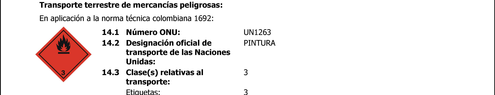
> Sección aproximada: 14; posición: (36.0, 181.1, 559.3, 282.5). Verificar contenido visual con PDF.

#### Imagen incrustada — PDF página 9, aparición 2

> Sección aproximada: 14; posición: (36.0, 282.5, 559.3, 346.1). Verificar contenido visual con PDF.

#### Imagen incrustada — PDF página 9, aparición 3

> Sección aproximada: 14; posición: (0.0, 346.1, 595.0, 383.9). Verificar contenido visual con PDF.

#### Imagen incrustada — PDF página 9, aparición 4
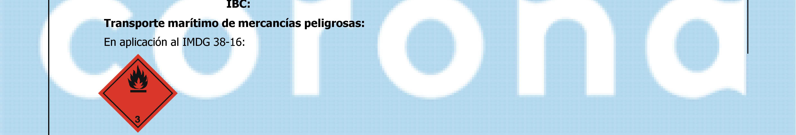
> Sección aproximada: 14; posición: (0.0, 383.9, 595.0, 485.3). Verificar contenido visual con PDF.

#### Imagen incrustada — PDF página 9, aparición 5

> Sección aproximada: 14; posición: (0.0, 485.3, 595.0, 497.3). Verificar contenido visual con PDF.

#### Imagen incrustada — PDF página 9, aparición 6

> Sección aproximada: 14; posición: (36.0, 497.3, 559.3, 586.7). Verificar contenido visual con PDF.

#### Imagen incrustada — PDF página 9, aparición 7

> Sección aproximada: 14; posición: (36.0, 586.7, 559.3, 610.7). Verificar contenido visual con PDF.

#### Imagen incrustada — PDF página 9, aparición 8
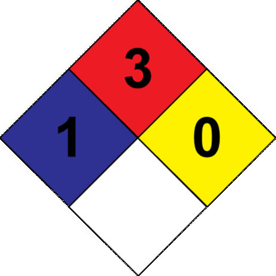
> Sección aproximada: 14; posición: (503.8, 36.0, 559.3, 91.6). Verificar contenido visual con PDF.

#### Imagen incrustada — PDF página 9, aparición 9

> Sección aproximada: 14; posición: (36.0, 51.6, 132.7, 76.0). Verificar contenido visual con PDF.

---

## Página PDF 10

Ficha de datos de seguridad
según Decreto 1496 de 2018
407141521 - RECUBRIMIENTO ANTIGRAFFITI

### SECCIÓN 14: INFORMACIÓN RELATIVA AL TRANSPORTE (continúa)

14.1
Número ONU:
UN1263
14.2
Designación oficial de
PINTURA
transporte de las Naciones
Unidas:
14.3
Clase(s) relativas al
3
transporte:
Etiquetas:
3
14.4
Grupo de
III
embalaje/envasado si se
aplica:
14.5
Riesgos ambientales:
No
14.6
Precauciones especiales para el usuario
Propiedades físico-químicas:
ver epígrafe 9
14.7
Transporte a granel con
No relevante
arreglo al anexo II de
MARPOL 73/78 y al Código
IBC:

### SECCIÓN 15: INFORMACIÓN SOBRE LA REGLAMENTACIÓN

15.1
Disposiciones específicas sobre seguridad, salud y medio ambiente para el producto de que se trate:
NTP (National Toxicology Program): No relevante
Disposiciones particulares en materia de protección de las personas o el medio ambiente:
Se recomienda emplear la información recopilada en esta hoja de datos de seguridad de materiales como datos de entrada en
una evaluación de riesgos de las circunstancias locales con el objeto de establecer las medidas necesarias de prevención de
riesgos para el manejo, utilización, almacenamiento y eliminación de este producto.
Otras legislaciones:
Resolución 0312 de 2019 – Nuevos estándares mínimos del SG-SST
CONPES 3868 - Política de gestión del riesgo asociado al uso de sustancias químicas.
Decreto 1079 de 2015 - decreto único reglamentario del sector transporte
NTC 1692 -Transporte de mercancías peligrosas. Definiciones, clasificación, marcado, etiquetado y rotulado
NTC 4532- Transporte de mercancías peligrosas. Tarjetas de emergencia para transporte de materiales. Elaboración
Decreto número 4741 de 2005
Decreto 1299 de 2008 -Reglamenta departamento de gestión ambiental de empresas a nivel industrial estado
Decreto 321 de 1999  - Adopta el Plan Nacional de Contingencia contra derrames de hidrocarburos, derivados y sustancias
nocivas.
NTC 4702 - 1 -Embalaje y Envases para Transporte de Mercancías Peligrosas Clase 1. Explosivos
NTC 4702 - 2 - Embalaje y Envases para Transporte de Mercancías Peligrosas Clase 2. Gases
NTC 4702 - 3 - Embalaje y Envases para Transporte de Mercancías Peligrosas Clase 3. Líquidos Inflamables
NTC 4702 - 4 - Embalaje y Envases para Transporte de Mercancías Peligrosas Clase 4. Sólidos Inflamables, Sustancias que
presentan riesgo de combustión espontánea, sustancias que en contacto con el agua desprenden gases inflamables.
NTC 4702 - 5 - Embalaje y Envases para Transporte de Mercancías Peligrosas Clase 5. Sustancias Comburentes y Peróxidos
Orgánicos
NTC 4702 - 6 - Embalaje y Envases para Transporte de Mercancías Peligrosas Clase 6. Sustancias Tóxicas e Infecciosas
NTC 4702 - 8 - Embalaje y Envases para Transporte de Mercancías Peligrosas Clase 8. Sustancias Corrosivas
NTC 4702 - 9 - Embalaje y Envases para Transporte de Mercancías Peligrosas Clase 9. Sustancias Peligrosas varias

### SECCIÓN 16: OTRAS INFORMACIONES

Legislación aplicable a fichas de datos de seguridad:
Esta hoja de datos de seguridad de materiales se ha desarrollado de acuerdo a la norma técnica colombiana NTC 4435:2010
Textos de las frases legislativas contempladas en la sección 2:
H340: Puede provocar defectos genéticos
H350: Puede provocar cáncer
H317: Puede provocar una reacción cutánea alérgica
H313: Puede ser nocivo en contacto con la piel
H304: Puede ser mortal en caso de ingestión y de penetración en las vías respiratorias
H226: Líquido y vapores inflamables
H319: Provoca irritación ocular grave
- CONTINÚA EN LA SIGUIENTE PÁGINA -
Emisión: 25/07/2019            Versión: 1
Página 10/11

#### Imagen incrustada — PDF página 10, aparición 1

> Sección aproximada: 16; posición: (0.0, 346.1, 595.0, 447.5). Verificar contenido visual con PDF.

#### Imagen incrustada — PDF página 10, aparición 2

> Sección aproximada: 16; posición: (0.0, 447.5, 595.0, 497.3). Verificar contenido visual con PDF.

#### Imagen incrustada — PDF página 10, aparición 3

> Sección aproximada: 16; posición: (503.8, 36.0, 559.3, 91.6). Verificar contenido visual con PDF.

#### Imagen incrustada — PDF página 10, aparición 4

> Sección aproximada: 16; posición: (36.0, 51.6, 132.7, 76.0). Verificar contenido visual con PDF.

#### Imagen incrustada — PDF página 10, aparición 5
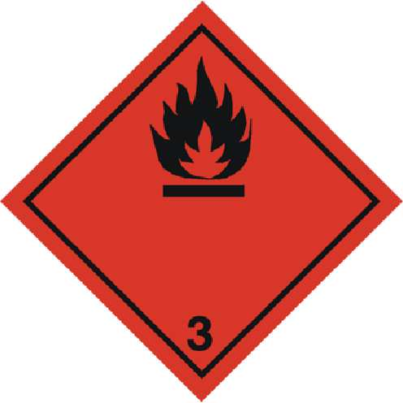
> Sección aproximada: 16; posición: (73.3, 121.9, 132.8, 181.4). Verificar contenido visual con PDF.

---

## Página PDF 11

Ficha de datos de seguridad
según Decreto 1496 de 2018
407141521 - RECUBRIMIENTO ANTIGRAFFITI

### SECCIÓN 16: OTRAS INFORMACIONES (continúa)

Textos de las frases legislativas contempladas en la sección 3:
Las frases indicadas no se refieren al producto en sí, son sólo a título informativo y hacen referencia a los componentes
individuales que aparecen en la sección 3
SGA:
Carc. 1B: H350 - Puede provocar cáncer
Les. Oc. 1: H318 - Provoca lesiones oculares graves
Muta. 1B: H340 - Puede provocar defectos genéticos
Sens. Cut. 1: H317 - Puede provocar una reacción cutánea alérgica
Tox. Agud. 5: H303 - Puede ser nocivo en caso de ingestión
Tox. Agud. 5: H313 - Puede ser nocivo en contacto con la piel
Tox. Asp. 1: H304 - Puede ser mortal en caso de ingestión y de penetración en las vías respiratorias
Consejos relativos a la formación:
Se recomienda formación mínima en materia de prevención de riesgos laborales al personal que va a manipular este producto,
con la finalidad de facilitar la comprensión e interpretación de esta hoja de datos de seguridad de materiales, así como del
etiquetado del producto.
Principales fuentes bibliográficas:
Instituto Colombiano de Normas Técnicas y Certificación (ICONTEC)
IARC:Agencia Internacional para la Investigación sobre Cáncer
OSHA:Occupational Safety and Health Administration, U.S Department of Labor
NTP:National Toxicology Program
TOXNET: Toxicology data network
Abreviaturas y acrónimos:
IMDG: Código Marítimo Internacional de Mercancías Peligrosas
IATA: Asociación Internacional de Transporte Aéreo
OACI: Organización de Aviación Civil Internacional
DQO:Demanda Quimica de oxígeno
DBO5:Demanda biológica de oxígeno a los 5 días
BCF: factor de bioconcentración
DL50: dosis letal 50
CL50: concentración letal 50
EC50: concentración efectiva 50
Log POW: logaritmo coeficiente partición octanol-agua
Koc: coeficiente de partición del carbono orgánico
La información contenida en esta ficha de datos de seguridad está fundamentada en fuentes, conocimientos técnicos y legislación vigente a nivel europeo y estatal, no pudiendo garantizar la
exactitud de la misma. Esta información no es posible considerarla como una garantía de las propiedades del producto, se trata simplemente de una descripción en cuanto a los requerimientos en
materia de seguridad. La metodología y condiciones de trabajo de los usuarios de este producto se encuentran fuera de nuestro conocimiento y control, siendo siempre responsabilidad última del
usuario tomar las medidas necesarias para adecuarse a las exigencias legislativas en cuanto a manipulación, almacenamiento, uso y eliminación de productos químicos. La información de esta
ficha de datos de seguridad de materiales únicamente se refiere a este producto, el cual no debe emplearse con fines distintos a los que se especifican.
FIN DE LA FICHA DE DATOS DE SEGURIDAD
Emisión: 25/07/2019            Versión: 1
Página 11/11

#### Imagen incrustada — PDF página 11, aparición 1

> Sección aproximada: 16; posición: (0.0, 346.1, 595.0, 447.5). Verificar contenido visual con PDF.

#### Imagen incrustada — PDF página 11, aparición 2

> Sección aproximada: 16; posición: (0.0, 447.5, 595.0, 497.3). Verificar contenido visual con PDF.

#### Imagen incrustada — PDF página 11, aparición 3

> Sección aproximada: 16; posición: (503.8, 36.0, 559.3, 91.6). Verificar contenido visual con PDF.

#### Imagen incrustada — PDF página 11, aparición 4

> Sección aproximada: 16; posición: (36.0, 51.6, 132.7, 76.0). Verificar contenido visual con PDF.

