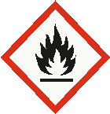
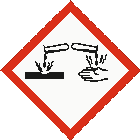

# FDS 72: transcripción documental automática

> Fuente: `FDS EVALUADAS/FDS 2023/FDS 72 - Sikafloor®-2430 CO Comp.B - SIKA.pdf`
> Páginas PDF: 12
> SHA256 original: 4e163cc3af2323749607b3382c55cf2e65525ee56a01225fa3c106c59f51af63
> Precaución: transcripción no validada de manera integral; no usar resultados de seguridad sin contrastar la ficha PDF original.

---

## Página PDF 1

FICHA DE DATOS DE SEGURIDAD
Sikafloor®-2430  Part B
Versión 3.0
Número de HDS: 100000030203
Fecha de revisión: 2023/08/15

### SECCIÓN 1. IDENTIFICACIÓN DE LA SUSTANCIA QUÍMICA PELIGROSA O MEZCLA Y DEL

PROVEEDOR O FABRICANTE
Nombre del producto
: Sikafloor®-2430  Part B
Informaciones sobre el fabricante o el proveedor
Compañía
:
Sika Colombia S.A.S.
Vereda Canavita km 20,5 Autopista Norte
Tocancipá, Cundinamarca
Colombia
Teléfono
:
(57-1) 8786333
Teléfono de emergencia
:
CISPROQUIM
Bogotá: 2886012 / 2886355
Resto del país: 01 8000 916012
Dirección de correo electróni-
:
controlcalidad.lab@co.sika.com
co
Fax
:
(57-1) 8786660
Uso recomendado del producto químico y restricciones de uso
Uso del producto
: Catalizador

### SECCIÓN 2. IDENTIFICACIÓN DE LOS PELIGROS

Clasificación según SGA (GHS)
Líquidos Inflamables
:
Categoría 3
Toxicidad aguda (Inhalación)
:
Categoría 4
Toxicidad aguda (Cutáneo)
:
Categoría 4
Corrosión/irritación cutáneas
:
Categoría 2
Lesiones oculares gra-
:
Categoría 1
ves/irritación ocular
Toxicidad sistémica específi-
:
Categoría 3 (Sistema respiratorio)
ca de órganos blanco - expo-
sición única
Toxicidad sistémica específi-
:
Categoría 2
ca de órganos blanco - Expo-
siciones repetidas
(Inhalación)
Peligro a corto plazo (agudo)
:
Categoría 2
para el medio ambiente acuá-
tico
Peligro a largo plazo (crónico) :
Categoría 3
1 / 12

#### Imagen incrustada — PDF página 1, aparición 1

> Sección aproximada: 2; posición: (486.9, 23.6, 561.3, 88.1). Verificar contenido visual con PDF.

---

## Página PDF 2

FICHA DE DATOS DE SEGURIDAD
Sikafloor®-2430  Part B
Versión 3.0
Número de HDS: 100000030203
Fecha de revisión: 2023/08/15
para el medio ambiente acuá-
tico
Etiqueta SGA (GHS)
Pictogramas de peligro
:
Palabra de advertencia
:
Peligro
Indicaciones de peligro
:
H226 Líquido y vapores inflamables.
H312 + H332 Nocivo en contacto con la piel o si se inhala.
H315 Provoca irritación cutánea.
H318 Provoca lesiones oculares graves.
H335 Puede irritar las vías respiratorias.
H373 Puede provocar daños en los órganos tras exposiciones
prolongadas o repetidas por inhalación.
H401 Tóxico para los organismos acuáticos.
H412 Nocivo para los organismos acuáticos, con efectos noci-
vos duraderos.
Consejos de prudencia
:
Prevención:
P210 Mantener alejado del calor, chispas, llamas al descubier-
to, superficies calientes y otras fuentes de ignición. No fumar.
P233 Mantener el recipiente herméticamente cerrado.
P240 Toma de tierra y enlace equipotencial del recipiente y del
equipo receptor.
P241 Utilizar material eléctrico, de ventilación o de iluminación/
antideflagrante.
P242 No utilizar herramientas que produzcan chispas.
P243 Tomar medidas de precaución contra las descargas elec-
trostáticas.
P260 No respirar nieblas o vapores.
P264 Lavarse la piel cuidadosamente después de la manipula-
ción.
P271 Utilizar sólo al aire libre o en un lugar bien ventilado.
P273 No dispersar en el medio ambiente.
P280 Usar guantes/ ropa de protección/ equipo de protección
para los ojos/ la cara.
Intervención:
P303 + P361 + P353 EN CASO DE CONTACTO CON LA PIEL
(o el pelo): Quitar inmediatamente toda la ropa contaminada.
Enjuagar la piel con agua.
P304 + P340 + P312 EN CASO DE INHALACIÓN: Transportar
a la persona al aire libre y mantenerla en una posición que le
facilite la respiración.Llamar a un CENTRO DE
TOXICOLOGÍA/médico/ si la persona se encuentra mal.
P305 + P351 + P338 + P310 EN CASO DE CONTACTO CON
LOS OJOS: Enjuagar con agua cuidadosamente durante varios
minutos. Quitar las lentes de contacto cuando estén presentes
y pueda hacerse con facilidad. Proseguir con el lavado. Llamar
inmediatamente a un CENTRO DE TOXICOLOGÍA o a un mé-
dico.
P314 Consultar a un médico si la persona se encuentra mal.
2 / 12

#### Imagen incrustada — PDF página 2, aparición 1

> Sección aproximada: 2; posición: (486.9, 23.6, 561.3, 88.1). Verificar contenido visual con PDF.

#### Imagen incrustada — PDF página 2, aparición 2

> Sección aproximada: 2; posición: (247.8, 171.5, 298.2, 223.7). Verificar contenido visual con PDF.

#### Imagen incrustada — PDF página 2, aparición 3

> Sección aproximada: 2; posición: (305.6, 171.5, 356.0, 223.7). Verificar contenido visual con PDF.

#### Imagen incrustada — PDF página 2, aparición 4

> Sección aproximada: 2; posición: (363.5, 171.5, 413.9, 221.9). Verificar contenido visual con PDF.

#### Imagen incrustada — PDF página 2, aparición 5

> Sección aproximada: 2; posición: (421.3, 171.5, 471.7, 223.7). Verificar contenido visual con PDF.

---

## Página PDF 3

### Tabla reconstruida desde el PDF original (página 3)

> Evidencia de disposición de columnas obtenida del PDF. Estado: **RECONSTRUCCION_AUTOMATICA_ALTA**. No indexar simultáneamente esta tabla y su transcripción lineal para evitar duplicados.

| Nombre químico | Columna 2 | CAS No. | Columna 4 | Concentración (% w/w) |
| --- | --- | --- | --- | --- |
| xileno | 1330-20-7 |  | >= 50 -< 70 |  |
| Poliaminoamida | No asignado |  | >= 10 -< 20 |  |
| etilbenceno | 100-41-4 |  | >= 10 -< 20 |  |
| 2-metilpropan-1-ol | 78-83-1 |  | >= 5 -< 10 |  |

FICHA DE DATOS DE SEGURIDAD
Sikafloor®-2430  Part B
Versión 3.0
Número de HDS: 100000030203
Fecha de revisión: 2023/08/15
P332 + P313 En caso de irritación cutánea: consultar a un
médico.
P362 + P364 Quitar la ropa contaminada y lavarla antes de
volverla a usar.
P370 + P378 En caso de incendio: Utilizar arena seca, produc-
to químico seco o espuma resistente al alcohol para la extin-
ción.
Almacenamiento:
P403 + P233 Almacenar en un lugar bien ventilado. Mantener
el recipiente herméticamente cerrado.
P403 + P235 Almacenar en un lugar bien ventilado. Mantener
fresco.
P405 Guardar bajo llave.
Eliminación:
P501 Eliminar el contenido/ recipiente en una planta de elimi-
nación de residuos aprobada.
Otros peligros no clasificables
No conocidos.

### SECCIÓN 3. COMPOSICIÓN/INFORMACIÓN SOBRE LOS INGREDIENTES

Sustancia / mezcla
:  Mezcla
Componentes
Nombre químico
CAS No.
Concentración (% w/w)

### 2-metilpropan-1-ol

78-83-1
>= 5 -< 10

### SECCIÓN 4. PRIMEROS AUXILIOS

Consejos generales
:
Retire a la persona de la zona peligrosa.
Consulte a un médico.
Muéstrele esta hoja de seguridad al doctor que esté de servi-
cio.
En caso de inhalación
:
Salga al aire libre.
Consultar a un médico después de una exposición importan-
te.
En caso de contacto con la
:
Quítese inmediatamente la ropa y zapatos contaminados.
piel
Elimínelo lavando con jabón y mucha agua.
Si persisten los síntomas, llame a un médico.
En caso de contacto con los
:
Incluso pequeñas salpicaduras en los ojos pueden causar
ojos
daños irreversibles en los tejidos y ceguera.
En caso de contacto con los ojos, lávelos inmediata y abun-
dantemente con agua y acuda a un médico.
Continúe lavando los ojos en el trayecto al hospital.
Quítese los lentes de contacto.
Manténgase el ojo bien abierto mientras se lava.
3 / 12

#### Imagen incrustada — PDF página 3, aparición 1

> Sección aproximada: 4; posición: (486.9, 23.6, 561.3, 88.1). Verificar contenido visual con PDF.

---

## Página PDF 4

FICHA DE DATOS DE SEGURIDAD
Sikafloor®-2430  Part B
Versión 3.0
Número de HDS: 100000030203
Fecha de revisión: 2023/08/15
En caso de ingestión
:
Lávese la boca con agua y después beba agua abundante.
No dé leche ni bebidas alcohólicas.
Nunca debe administrarse nada por la boca a una persona
inconsciente.
Consulte al médico.
Síntomas y efectos más im-
:
Nocivo en contacto con la piel o si se inhala.
portante, agudos y retarda-
Provoca irritación cutánea.
dos
Provoca lesiones oculares graves.
Puede irritar las vías respiratorias.
Puede provocar daños en los órganos tras exposiciones pro-
longadas o repetidas por inhalación.
efectos irritantes
Tos
Desordenes respiratorios
Lacrimación excesiva
Dolor de cabeza
Dermatitis
Trastornos cutáneos
Vea la Sección 11 para obtener información detallada sobre la
salud y los síntomas.
Notas especiales para un
:
Trate sintomáticamente.
medico tratante

### SECCIÓN 5. MEDIDAS CONTRA INCENDIOS

Medios de extinción apropia-
:
Espuma resistente a los alcoholes
dos
Dióxido de carbono (CO2)
Producto químico seco
Agentes de extinción inapro-
:
Agua
piados
Chorro de agua de gran volumen
Peligros específicos durante
:
No use un chorro compacto de agua ya que puede dispersar
la extincion de incendios
y extender el fuego.
Productos de combustión
:  No se conocen productos de combustión peligrosos
peligrosos
Métodos específicos de ex-
:
Utilice rocío de agua para enfriar los recipientes cerrados.
tinción
Equipo de protección espe-
:
En caso de incendio, utilice un equipo respiratorio autónomo.
cial para los bomberos

### SECCIÓN 6. MEDIDAS QUE DEBEN TOMARSE EN CASO DE DERRAME ACCIDENTAL O FUGA

ACCIDENTAL
Precauciones personales,
:
Utilice equipo de protección personal.
equipo de protección y pro-
Retire todas las fuentes de ignición.
cedimientos de emergencia
Negar el acceso a personas sin protección.
Precauciones relativas al
:
Evite que el producto vaya al alcantarillado.
4 / 12

#### Imagen incrustada — PDF página 4, aparición 1

> Sección aproximada: 6; posición: (486.9, 23.6, 561.3, 88.1). Verificar contenido visual con PDF.

---

## Página PDF 5

FICHA DE DATOS DE SEGURIDAD
Sikafloor®-2430  Part B
Versión 3.0
Número de HDS: 100000030203
Fecha de revisión: 2023/08/15
medio ambiente
Si el producto contamina los ríos, lagos o alcantarillados, in-
formar a las autoridades respectivas.
Métodos y materiales de
:
Contener y recoger el derrame con material absorbente que
contención y limpieza
no sea combustible (p. ej. arena, tierra, barro de diatomeas,
vermiculita), y meterlo en un envase para su eliminación de
acuerdo con las reglamentaciones locales y nacionales (ver
sección 13).

### SECCIÓN 7. MANEJO Y ALMACENAMIENTO

Sugerencias para la protec-
:  Utilice un equipo a prueba de explosiones.
ción contra incendios y ex-
Mantener alejado del calor/ de chispas/ de llamas al descu-
plosiones
bierto/ de superficies calientes. No fumar.
Tomar medidas de precaución contra la acumulación de car-
gas electrostáticas.
Consejos para una manipu-
:
No respire los vapores ni la niebla de la pulverización.
lación segura
Evitar sobrepasar los límites dados de exposición profesional
(ver sección 8).
Evitar todo contacto con los ojos, la piel o la ropa.
Ver sección 8 para el equipo de protección personal.
Fumar, comer y beber debe prohibirse en el área de aplica-
ción.
Tomar medidas de precaución contra las descargas electros-
táticas.
Provea de suficiente intercambio de aire y/o de extracción en
los lugares de trabajo.
Abra el tambor con precaución, ya que el contenido puede
estar presurizado.
Adopte las acciones necesarias para evitar descargas de
electricidad estática (que podrían ocasionar la inflamación de
los vapores orgánicos).
Cuando se manejen productos químicos, siga las medidas
estándar de higiene.
Condiciones para el almace-
:
Almacénelo en el envase original.
namiento seguro
Mantenga en un lugar bien ventilado.
Los contenedores que se abren deben ser cuidadosamente
resellados y mantenerlos en posición vertical para evitar fu-
gas.
Observar las indicaciones de la etiqueta.
Almacenar en conformidad con la reglamentación local.

### SECCIÓN 8. CONTROLES DE EXPOSICIÓN/PROTECCIÓN PERSONAL

Componentes con parámetros de control en el área de trabajo
Componentes
CAS No.
Tipo de valor
Parámetros de
Bases
(Forma de
control / Concen-
exposición)
tración permisible
xileno
1330-20-7
TWA
20 ppm
ACGIH
etilbenceno
100-41-4
TWA
20 ppm
ACGIH

### 2-metilpropan-1-ol

78-83-1
TWA
50 ppm
ACGIH
5 / 12

#### Imagen incrustada — PDF página 5, aparición 1

> Sección aproximada: 2; posición: (486.9, 23.6, 561.3, 88.1). Verificar contenido visual con PDF.

---

## Página PDF 6

FICHA DE DATOS DE SEGURIDAD
Sikafloor®-2430  Part B
Versión 3.0
Número de HDS: 100000030203
Fecha de revisión: 2023/08/15
Límites biológicos de exposición ocupacional
Componentes
CAS No.
Parámetros
Análisis
Tiempo
Concentra-
Bases
de control
biológico
de toma
ción permisi-
de mues-
ble
tras
xileno
1330-20-7 Acidos me-
Orina
Al final
1.5 g/g crea-
ACGIH
tilhipúricos
del turno
tinina
BEI
(Tan
pronto
como sea
posible
después
de que
cese la
exposi-
ción)
etilbenceno
100-41-4
Suma del
Orina
Al final
0.15 g/g
ACGIH
ácido man-
del turno
creatinina
BEI
délico y el
(Tan
ácido fenil-
pronto
glioxílico
como sea
posible
después
de que
cese la
exposi-
ción)
Protección personal
Protección respiratoria
:
Utilice protección respiratoria a menos que exista una venti-
lación de escape adecuada o que la evaluación de la exposi-
ción indique que el nivel de exposición está dentro de las
pautas recomendadas.
La clase de filtro para el respirador debe ser adecuada para
la concentración máxima prevista del contaminante
(gas/vapor/aerosol/partículas) que puede presentarse al ma-
nejar el producto. Si se excede esta concentración, se debe
utilizar un aparato respiratorio autónomo.
Protección de las manos
:
Guantes químico-resistentes e impermeables que cumplan
con estándares aprobados deben ser utilizados cuando se
manejen productos químicos y la evaluación del riesgo indica
que es necesario.
Protección de los ojos
:
Equipo de protección ocular que cumpla con estándares
aprobados debe ser utilizado cuando la evaluación del riesgo
indica que es necesario.
Protección de la piel y del
:
Elegir la protección para el cuerpo según sus caraterísticas,
cuerpo
la concentración y la cantidad de sustancias peligrosas, y el
lugar específico de trabajo.
Medidas de higiene
:
Manipúlelo con las precauciones de higiene industrial ade-
cuadas, y respete las prácticas de seguridad.
No coma ni beba durante su utilización.
No fume durante su utilización.
Lavarse las manos antes de los descansos y después de
6 / 12

#### Imagen incrustada — PDF página 6, aparición 1

> Sección aproximada: 2; posición: (486.9, 23.6, 561.3, 88.1). Verificar contenido visual con PDF.

---

## Página PDF 7

FICHA DE DATOS DE SEGURIDAD
Sikafloor®-2430  Part B
Versión 3.0
Número de HDS: 100000030203
Fecha de revisión: 2023/08/15
terminar la jornada laboral.

### SECCIÓN 9. PROPIEDADES FÍSICAS Y QUÍMICAS

Aspecto
:
líquido
Color
:  varios
Olor
:  característico
Umbral de olor
:  Sin datos disponibles
pH
:
8
Punto de fusión/rango / Punto
:
Sin datos disponibles
de congelación
Punto / intervalo de ebullición
:
Sin datos disponibles
Punto de inflamación
:
28 °C (28 °C)
Tasa de evaporación
:  Sin datos disponibles
Inflamabilidad (sólido, gas)
:
Sin datos disponibles
Límite superior de explosivi-
:
6,2 %(V)
dad / Límite de inflamabilidad
superior
Límite inferior de explosividad
:
1 %(V)
/ Límite de inflamabilidad infe-
rior
Presión de vapor
:
11,9999 hPa
Densidad relativa de vapor
:
Sin datos disponibles
Densidad
:
aprox. 1,5 g/cm3 (20 °C (20 °C))
Solubilidad
Hidrosolubilidad
:
insoluble
Solubilidad en otros disol-
:
Sin datos disponibles
ventes
Coeficiente de reparto n-
:
Sin datos disponibles
octanol/agua
Temperatura de ignición es-
:
415 °C
pontánea
Temperatura de descomposi-
:  Sin datos disponibles
ción
Viscosidad
Viscosidad, dinámica
:
Sin datos disponibles
Viscosidad, cinemática
:
> 20,5 mm2/s ( 40 °C (40 °C))
Propiedades explosivas
:
Sin datos disponibles
7 / 12

#### Imagen incrustada — PDF página 7, aparición 1

> Sección aproximada: 9; posición: (486.9, 23.6, 561.3, 88.1). Verificar contenido visual con PDF.

---

## Página PDF 8

FICHA DE DATOS DE SEGURIDAD
Sikafloor®-2430  Part B
Versión 3.0
Número de HDS: 100000030203
Fecha de revisión: 2023/08/15
Propiedades comburentes
:
Sin datos disponibles

### SECCIÓN 10. ESTABILIDAD Y REACTIVIDAD

Reactividad
:  No se conoce ninguna reacción peligrosa bajo condiciones de
uso normal.
Estabilidad química
:  El producto es químicamente estable.
Posibilidad de reacciones
:
Estable bajo las condiciones de almacenamiento recomenda-
peligrosas
das.
Los vapores pueden formar una mezcla explosiva con el aire.
Condiciones que deben evi-
:
Calor, llamas y chispas.
tarse
Materiales incompatibles
:  Sin datos disponibles

### SECCIÓN 11. INFORMACIÓN TOXICOLÓGICA

Toxicidad aguda
Nocivo en contacto con la piel o si se inhala.
Componentes:
xileno:
Toxicidad oral aguda
:  DL50 Oral (Rata): 3.523 mg/kg
etilbenceno:
Toxicidad oral aguda
:  DL50 Oral (Rata): 3.500 mg/kg
Toxicidad dérmica aguda
:  LD50 Dermico (Conejo): 5.510 mg/kg
Corrosión o irritación cutáneas
Provoca irritación cutánea.
Lesiones oculares graves/irritación ocular
Provoca lesiones oculares graves.
Sensibilización respiratoria o cutánea
Sensibilización cutánea
No se clasifica debido a la falta de datos.
Sensibilización respiratoria
No se clasifica debido a la falta de datos.
Mutagenicidad en células germinales
No se clasifica debido a la falta de datos.
Carcinogenicidad
No se clasifica debido a la falta de datos.
Toxicidad para la reproducción
No se clasifica debido a la falta de datos.
8 / 12

#### Imagen incrustada — PDF página 8, aparición 1

> Sección aproximada: 11; posición: (486.9, 23.6, 561.3, 88.1). Verificar contenido visual con PDF.

---

## Página PDF 9

FICHA DE DATOS DE SEGURIDAD
Sikafloor®-2430  Part B
Versión 3.0
Número de HDS: 100000030203
Fecha de revisión: 2023/08/15
Toxicidad sistémica específica de órganos blanco - exposición única
Puede irritar las vías respiratorias.
Toxicidad sistémica específica de órganos blanco - exposiciones repetidas
Puede provocar daños en los órganos tras exposiciones prolongadas o repetidas por inhalación.
Toxicidad por aspiración
No se clasifica debido a la falta de datos.

### SECCIÓN 12. INFORMACIÓN ECOTOXICOLOGICA

Ecotoxicidad
Componentes:
xileno:
Toxicidad para peces (Toxi-
:
NOEC (Oncorhynchus mykiss (trucha irisada)): > 1,3 mg/l
cidad crónica)
Tiempo de exposición: 56 d
Toxicidad para la dafnia y
:
NOEC (Daphnia (Dafnia)): 1,17 mg/l
otros invertebrados acuáticos
Tiempo de exposición: 7 d
(Toxicidad crónica)
Persistencia y degradabilidad
Sin datos disponibles
Potencial de bioacumulación
Sin datos disponibles
Movilidad en el suelo
Sin datos disponibles
Otros efectos adversos
Producto:
Información ecológica com-
:  No se puede excluir un peligro para el medio ambiente en el
plementaria
caso de una manipulación o eliminación no profesional.
Nocivo para los organismos acuáticos, con efectos nocivos
duraderos.

### SECCIÓN 13. INFORMACIÓN RELATIVA A LA ELIMINACIÓN DE LOS PRODUCTOS

Métodos de eliminación
Residuos
:
Envíese a una compañía autorizada para la gestión de resi-
duos.
Evite que el producto penetre en los desagües, tuberías, o la
tierra (suelos).
No contamine los estanques, cursos de agua o zanjas con el
producto químico o el contendor utilizado.
Envases contaminados
:
Vacíe el contenido restante.
Eliminar como producto no usado.
No reutilice los recipientes vacíos.
No queme, ni utilice un soplete de corte, en el tambor vacío.
9 / 12

#### Imagen incrustada — PDF página 9, aparición 1

> Sección aproximada: 13; posición: (486.9, 23.6, 561.3, 88.1). Verificar contenido visual con PDF.

---

## Página PDF 10

FICHA DE DATOS DE SEGURIDAD
Sikafloor®-2430  Part B
Versión 3.0
Número de HDS: 100000030203
Fecha de revisión: 2023/08/15

### SECCIÓN 14. INFORMACIÓN RELATIVA AL TRANSPORTE

Regulaciones internacionales
UNRTDG
Número ONU
:
UN 1263
Designación oficial de trans-
:
PAINT RELATED MATERIAL
porte
Clase
:
3
Grupo de embalaje
:
III
Etiquetas
:
3
IATA-DGR
No. UN/ID
:
UN 1263
Designación oficial de trans-
:
Paint related material
porte
Clase
:
3
Grupo de embalaje
:
III
Etiquetas
:
Flammable Liquids
Instrucción de embalaje
:
366
(avión de carga)
Instrucción de embalaje
:
355
(avión de pasajeros)
Código-IMDG
Número ONU
:
UN 1263
Designación oficial de trans-
:
PAINT RELATED MATERIAL
porte
Clase
:
3
Grupo de embalaje
:
III
Etiquetas
:
3
Código EmS
:
F-E, S-E
Contaminante marino
:
no
Transporte a granel de acuerdo a instrumentos IMO
No aplicable para el producto tal y como se proveyó.
Precauciones especiales para los usuarios
La(s) clasificación(es) de transporte presente(s) tienen solamente propósitos informativos y se
basa(n) únicamente en las propiedades del material sin envasar/embalar, descritas dentro de es-
ta Hoja de Datos de Seguridad. Las clasificaciones de transporte pueden variar según el modo
de transporte, el tamaño del envase/embalaje y las variaciones en los reglamentos regionales o
del país.

### SECCIÓN 15. INFORMACIÓN REGLAMENTARIA

Reglamentación medioambiental, seguridad y salud específica para la sustancia o mezcla
Convención Internacional sobre las Armas Químicas
:
No aplicable
(CWC) Programas sobre los Productos Químicos Tó-
xicos y los Precursores (Louisiana Administrative Co-
de, Title 33,Part V Section 10101 et. seq.)
Sustancias y productos químicos controlados por el
:
xileno
Ministerio de Justicia

### 2-metilpropan-1-ol

Listado de Sustancias incluídas como Sustancias de
:
No aplicable
Control Especial y Sometidas a Fiscalización por el
Ministerio de Salud y Protección Social
10 / 12

#### Imagen incrustada — PDF página 10, aparición 1

> Sección aproximada: 2; posición: (486.9, 23.6, 561.3, 88.1). Verificar contenido visual con PDF.

---

## Página PDF 11

FICHA DE DATOS DE SEGURIDAD
Sikafloor®-2430  Part B
Versión 3.0
Número de HDS: 100000030203
Fecha de revisión: 2023/08/15
Resolución 2715 de 2014 Por la cual se establecen las
:
No aplicable
sustancias que deben ser objeto de registro de control
de venta al menudeo, con base en los criterios de
clasificación que se definen.

### SECCIÓN 16. OTRA INFORMACIÓN INCLUIDAS LAS RELATIVAS A LA PREPARACIÓN Y

ACTUALIZACIÓN DE LAS HOJAS DE DATOS DE SEGURIDAD
Fecha de revisión
:  2023/08/15
formato de fecha
:
aaaa/mm/dd
Información adicional
NFPA:
HMIS® IV:
Inflamabilidad
SALUD
*
3
3
INFLAMABILIDAD
3
Salud
2
Inestabilidad
0
RIESGO FÍSICO
0
Las clasificaciones HMIS® se basan en
una escala del 0 al 4 en la que 0 significa
riesgos o peligros mínimos y 4 significa
riesgos o peligros serios. El "*" represen-
Peligro especial
ta un peligro crónico, mientras que la "/"
representa la ausencia de un peligro
crónico.
Texto completo de otras abreviaturas
ACGIH
:
Valores límite (TLV) de la ACGIH,USA
ACGIH BEI
:
ACGIH - Índices  Biológicos de Exposición (BEI)
ACGIH / TWA
:
Tiempo promedio ponderado
ADR
:
Accord européen relatif au transport international des mar-
chandises Dangereuses par Route
CAS
:
Chemical Abstracts Service
DNEL
:
Derived no-effect level
EC50
:
Half maximal effective concentration
GHS
:
Globally Harmonized System
IATA
:
International Air Transport Association
IMDG
:
International Maritime Code for Dangerous Goods
LD50
:
Median lethal dosis (the amount of a material, given all at
once, which causes the death of 50% (one half) of a group of
test animals)
LC50
:
Median lethal concentration (concentrations of the chemical in
air that kills 50% of the test animals during the observation
period)
MARPOL
:
International Convention for the Prevention of Pollution from
Ships, 1973 as modified by the Protocol of 1978
11 / 12

#### Imagen incrustada — PDF página 11, aparición 1

> Sección aproximada: 16; posición: (486.9, 23.6, 561.3, 88.1). Verificar contenido visual con PDF.

#### Imagen incrustada — PDF página 11, aparición 2

> Sección aproximada: 16; posición: (138.5, 345.2, 234.1, 440.4). Verificar contenido visual con PDF.

#### Imagen incrustada — PDF página 11, aparición 3

> Sección aproximada: 16; posición: (309.1, 322.2, 494.4, 422.0). Verificar contenido visual con PDF.

---

## Página PDF 12

FICHA DE DATOS DE SEGURIDAD
Sikafloor®-2430  Part B
Versión 3.0
Número de HDS: 100000030203
Fecha de revisión: 2023/08/15
OEL
:
Occupational Exposure Limit
PBT
:
Persistent, bioaccumulative and toxic
PNEC
:
Predicted no effect concentration
REACH
:
Regulation (EC) No 1907/2006 of the European Parliament
and of the Council of 18 December 2006 concerning the Re-
gistration, Evaluation, Authorisation and Restriction of Chemi-
cals (REACH), establishing a European Chemicals Agency
SVHC
:
Substances of Very High Concern
vPvB
:
Very persistent and very bioaccumulative
La informacion contenida en este ficha de datos de seguridad corresponde a nuestro nivel de
conocimiento en el momento de su publicacion. Quedan excluidas todas las garantias. Se
aplicaran nuestras condiciones generales de venta en vigor. Por favor, consulte la Hoja de
Datos del Producto  antes de su uso y procesamiento.
CO / 1X
12 / 12

#### Imagen incrustada — PDF página 12, aparición 1

> Sección aproximada: 16; posición: (486.9, 23.6, 561.3, 88.1). Verificar contenido visual con PDF.

